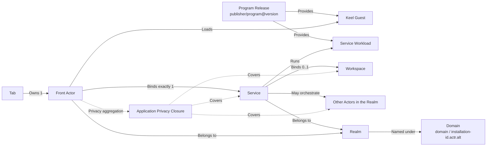

# 02. Domain model

## 1. Overview



## 2. Seven core objects

### 2.1 Program

The stable name of a program; it does not include install state or a running instance.

```text
ProgramId = publisher/program
```

Example:

```text
notes.example/team-notes
```

`publisher` is a normalized DNS domain; `program` is a name unique under that Publisher.

### 2.2 Program Release

An immutable version of a program:

```text
ProgramReleaseId = publisher/program@version
```

The Publisher-signed release record pins the Service and Front package digests. The packages
carry their respective Workloads, contracts, and Host requirements. The Service manifest declares
static Workspace requirements in `[workspace]`. Actrium applies provisioning, actual grants,
quotas, and other instance policies through deployment and authorization.

### 2.3 Service

The instance's Service: exactly one per Realm, created together with the Realm:

- has a durable `ActorId`;
- always runs the package the Realm Profile's `package` points to;
- holds the Workspace capability;
- holds the instance's configuration and access control;
- its lifecycle is independent of Tab;
- can run locally or remotely;
- may orchestrate other Actors, but exposes a single primary facade to the Front.

Service is not a "program type", nor a load-balancing candidate that can be freely swapped.

### 2.4 Front Actor

The short-lived interactive Actor for one resident app Tab:

- its Actor type and Keel Guest Workload come from the verified Front package;
- contains the Keel Host, the Actr client, the capability broker, and lifecycle management;
- loads a verified Keel Guest;
- holds only the restricted capability bound to the Service;
- can be rebuilt after the Tab closes, crashes, or is reclaimed by the system;
- its ActorId can be session-scoped; it carries no durable business identity.

### 2.5 Tab

The user-interaction container in Actrium Shell. A Tab holds local browsing state, such as:

- a local `tab_id`;
- the current normalized Realm link (`actr://` URI);
- the in-page route;
- the back/forward stack;
- the display title and icon;
- suspend/restore metadata.

A Tab does not hold Workspace keys and owns no business data.

A Tab record can outlive memory reclamation. It is then a dormant Tab with no live Front Actor; reactivating it rebuilds a new Front Actor from the same Realm link.

### 2.6 Workspace

The Service's durable data boundary. It is not a simple file path but a capability hosted by the Actr Host:

```text
WorkspaceBinding
├── workspace_id
├── provider_type
├── provider_locator
├── access_mode
├── credential_ref
├── lease_policy
└── backup/migration metadata
```

`credential_ref` points into system secure storage; it must never appear in a URL, an ordinary database, or the Guest launch context.

### 2.7 Realm

The trust and governance domain of one application instance. Creating an instance creates a new Realm under the chosen Realm domain; the instance's Service, the other Actors it orchestrates, and the Fronts that Attach to it all belong to this Realm. A Realm does not follow the Program, and it is not an organization-level membership domain.

```text
Realm name = <realm_id>@<domain>                      # networked, e.g. k7m2q9xh@acme.com
           | <realm_id>@<installation-id>.actr.alt    # local
```

- The Realm domain belongs to its owner and serves only as a naturally unique, ownership-verifiable name; it carries no infrastructure. A local Realm uses the pseudo-domain `<installation-id>.actr.alt` (generated at random at install time, never resolved via DNS), belonging to that Actrium installation;
- the domain's Realm signing key is the long-term trust root for every Realm under that domain and signs each Realm Profile. Its `package` records the Service package's download location, SHA-256, and Actor type.
- the RealmId is unique within the domain, immutable after creation, and never reused after retirement;
- one Actr Facility Provider (Signaling, TURN, Issuer) hosts a large number of Realms; a Realm is bound to one Actr Facility Provider at creation and can never switch afterward;
- the Actr Facility Provider records the members of a networked Realm: exactly one owner (the creator, transferable), the rest editors or viewers; members join with a one-time Realm invitation, and each client registers one Realm client key. A local Realm has no members.

A Publisher domain names a program (who publishes it); a Realm domain names a deployment (who operates it). The same Program Release can run at `notes@acme.com` and also at `notes@foo.org`.

## 3. The precise definition of "Tab–Service 1:1"

### 3.1 Product invariants

At any point in runtime:

- a resident Tab in loading/running/suspended state has exactly one Front Actor;
- a dormant Tab that Shell has discarded but kept in the Tab strip has no live Front Actor;
- a Front Actor is bound to at most one Service;
- once startup completes, a Front Actor must be bound to exactly one Service;
- a Service can temporarily have no Front;
- a Service and its historical Fronts are not a permanent bijection.

Formally:

```text
Tab 1 ── 0..1 Live Front Actor
Live Front Actor 1 ── 1 Service
Service 1 ── 0..1 Active Front Lease (v1 exclusive)
Service 1 ── 0..1 Workspace
```

The same Service can be reconnected to by multiple Front Actors over time; this is not the runtime cardinality at a single moment. v1's default session policy is `exclusive`: only one interactive Front holds the primary lease at any given time.

### 3.2 Why we do not define a strict global bijection

If a Service could only ever belong to one specific Front Actor, contradictions would appear immediately:

- whether the Service must be deleted when the Tab closes;
- how a new Front Actor connects after Actrium restarts;
- whether a Front crash leaves the Workspace without an owner;
- why reopening from a favorite could not resume the original instance;
- why the same instance would have to change identity after migrating to a new device.

So the simplest model is not "the two lifecycles locked together", but:

> A Front always faces exactly one Service; the Service exists independently and accepts new, authorized Front sessions.

### 3.3 Exclusive vs. shared

Actrium's v1 session policy uses `exclusive`.

- when the same Service is already open locally, opening the same Realm link focuses the existing Tab;
- when another device requests a connection, the Service may refuse, wait for the lease to expire, or trigger a user-confirmed takeover;
- after a network interruption there is a bounded lease grace period, to keep a transient disconnect from being mistaken for release.

`shared` is a future capability that requires additionally defining multi-session permissions, concurrent writes, focus, and collaboration state; it is not implicit v1 behavior.

## 4. Identity, type, and instance

### 4.1 Program Release and Actor type

A Program Release corresponds one-to-one with a Service's Actor type (`ActrType` in code):

```text
publisher/program@version
            ↓
ActrType {
  publisher    = publisher
  name         = program
  version      = version
}
```

Actr currently shares a shorter `Name` constraint between publisher and name. The target design must change Publisher validation to full DNS/IDNA rules and support A-label domains up to 253 bytes.

### 4.2 ActorId

A Service's ActorId must satisfy:

- `serial + Realm name` is globally distinguishable as a whole;
- it carries a verifiable, resolvable Realm name on its own;
- it is permanently unique within the Realm;
- the Realm must never assign a used ID to another instance;
- it stays unchanged across normal credential renewal, hard re-auth, signaling switchover, process restart, and migration of where it runs;
- it is bound to the Actor's long-term key;
- it can resolve to a current online address, or explicitly report offline;
- the Actor type is not part of the ID: it is carried by registration and the Actor credential, and must match the Program Release.

An ActorId contains only the Actor serial and the Realm name, so the Realm can be resolved from the ActorId itself:

```text
<serial>.<realm_id>@<domain>
e.g. 2af01.notes@acme.com
```

For a local Realm, for example, `2af01.h3x8p2wq@<installation-id>.actr.alt`.

At the same time, its lifecycle semantics must be upgraded from "this registration's address" to "a renewable, durable logical Actor identity".

### 4.3 ActorId is not a secret

Neither the ActorId nor the Realm link is a secret; neither alone grants access. A connection must also verify:

- the Actor credential issued by the Realm;
- the application permissions of the Service's owner/members;
- the Front's session challenge;
- the Service package digest and protocol fingerprint.
- the attachment lease.

### 4.4 No added public ServiceInstanceId

The target model does not add another public "logical service key" layer to the URL. If the ActorId cannot be made stable, the fix belongs in the ActorId, not something every upper layer has to maintain indefinitely:

```text
ServiceInstanceId → current ActorId
```

Actrium's local database may have a `record_id` for pure storage purposes, but it is not a network identity and never appears in a shared URL.

## 5. State ownership

| State | Authoritative owner | Notes |
|---|---|---|
| Tab arrangement, back/forward | Actrium Shell | Can be synced; loss must not break business state |
| Guest UI transient state | Front Actor / Keel Guest | Can be snapshotted on suspend; may be rebuilt after a crash |
| Current instance (Realm name) | Tab Session | Derived from the normalized Realm link |
| Business state | Service | Never held in the Front |
| Workspace content | Workspace Provider | Accessed via the Service's capability |
| Workspace binding | Service | Cannot be rebound by the Front |
| Program Release metadata | Program Catalog | The verified release record pins the Service and Front package digests |
| Actor long-term private key | Secure storage | Never enters ordinary SQLite |
| Realm domain trust (Realm signing key pin) | Actrium Realm Manager | Fixed after first confirmation; updated only via the signed rotation chain |
| Realm client key | Secure storage | Independent per Realm (i.e. per instance); registering it with the Actr Facility Provider constitutes Realm membership; revocable |
| Members and roles | Actr Facility Provider | Exactly one owner per Realm; the role is written into the Actor credential and enforced by the Service |
| Permission grants | Actrium Permission Store | Scoped to publisher/program/major/digest/Workspace |
| ActorAssurance | Verifier (issuer ≠ subject) | A node-level conclusion for an exact `ActorStateDigest` |
| ApplicationAssurance | Application assessor | The aggregated conclusion for the rootless graph's current cut; display also requires Ready |

## 6. Create, open, and discover

Three actions must be kept separate:

### 6.1 Create instance

Creating an instance is a local Actrium operation; it is never triggered by a link:

1. the user selects a Program Release or provides both packages for local development. Actrium verifies the Service and Front packages.
2. choose a Realm domain (a local Realm is created by default), generate a random RealmId (the user may explicitly change it to a readable name), and choose a Workspace;
3. Create a Realm under that domain. A local Realm creates a record on the device. Other Realms require authorization from the Realm signing key holder. The Realm Profile's `package` records the verified Service package's address, SHA-256, and Actor type.
4. create the Service inside that Realm and obtain its durable ActorId;
5. use it to create the Front session; the address bar shows the instance's Realm link.

Steps 3–4 form one transaction keyed by `idempotency_key`, executed strictly in order: obtain the holder's authorization → the Actr Facility Provider creates a pending Realm → sign the Realm Profile and submit it with `publish_profile` → the Realm becomes active → redeem the owner invite and become the owner → create the Service and obtain its ActorId. In v1 a Realm under an Actr Facility Provider's own domain is created by its operator, and Actrium starts from redeeming the owner invite. If any step fails, no Service is created; the Actr Facility Provider automatically cleans up expired pending Realms; the random RealmId is generated only once and reused on retries with the same `idempotency_key`; the Actr Facility Provider's idempotency key is `(realm, requester)`, which continues the same pending Realm instead of creating another; a different requester using the same name, or a hit on an existing active Realm or an Actr Facility Provider tombstone, returns a conflict. For a local Realm there are only two steps: the local record and the Service.

A new instance always means a new Realm. An upgrade creates a new Service in the same Realm with
the existing membership and application permissions. Its ActorId changes according to the migration
rules. After confirming the switch, the Realm publishes a Profile whose `package` points to the new
Service archive. The matching release record pins its Front package.

### 6.2 Open instance

To open a Realm link `actr://<domain>/<realm_id>[…]`, verify the Realm Profile and the Service package
identified by `package`, then verify the Front package pinned by the matching Program Release record.
Find the Service inside the Realm by the Service package's Actor type and Attach.

- no load balancing, no switching to another Realm;
- never creates a new instance because of offline;
- there must be exactly one Actor of the package's type in that Realm; zero or more than one is an error, and it never picks among them;
- an Actor link connects directly to the Actor it names, and is rejected if its type does not match the package;
- if the Realm domain is not yet trusted, ask the user to confirm it; if the user has not yet joined that Realm, go through the Realm invitation/join flow.

Discovery by Actor type is scoped to this Realm; v1 does no cross-Realm discovery.

## 7. Service facade

To keep the Front minimal, the Guest only gets:

```typescript
service.call(route, request)
service.tell(route, event)
service.on(eventName, handler)
```

The Guest does not directly get:

- `discover(ActrType)`;
- `call(ActorId)`;
- Signaling/TURN configuration;
- a Workspace handle;
- the Service credential;
- any socket.

If a program needs multiple background Actors, the Service performs discovery, creation, and orchestration within its own permission boundary; these Actors belong to the same Realm as it. Cross-instance (cross-Realm) calls are made by the Service backend, which obtains a client identity under the target Realm's join policy.

## 8. System programs

Actrium Shell's address bar, Tab strip, permission prompts, and security information belong to the Shell; they are not ordinary Tab content.

Visible pages such as History, Favorites, Program Catalog, and Service Inventory should take one of the following two forms:

1. as a native Shell management panel, never inside a normal application Tab; or
2. as an Actrium-owned, signed system Program, still following the Front–Service model.

System pages must not expose an implicit set of Guest permissions unavailable to third parties. System-level capabilities must be granted by a different signing tier and an explicit Host policy.

## 9. Application graph

The Front is directly bound only to the Service, but assurance must cover the **rootless** connected component of valid dependencies that the Front belongs to. Both the Front and the Service are only entry points for locating it, not roots of the graph.

```text
Front ──locates──▶ CC(U(valid Transfer(ActorId)))
```

The graph is not a static Publisher list but the Actor dependencies in the effective declaration. An invalid channel blocks; it is not scored. The displayed color takes the weakest of each node's items, and requires `Ready`.

Key constraints:

- Actor health status cannot substitute for `ActorAssurance`;
- an Actor's self-report cannot substitute for a verifier's conclusion, nor can it self-sign;
- if any node is `UNKNOWN`, the application is at most yellow;
- if any node is `UNCONTROLLED`, the application is red;
- if any member is suspended, green must not be shown;
- a member that does not depend on the changed node may `LocalContinue`;
- a new configuration applies only to new data;
- full semantics are in [docs/security](../../architecture/security/actrium/README.zh.md) and [13](13-privacy-state-and-aggregation.md).
</content>
