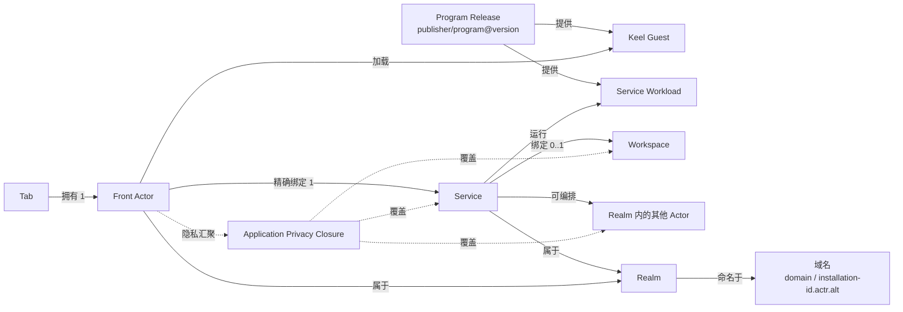

# 02. 领域模型

## 1. 总览



## 2. 七个核心对象

### 2.1 Program

程序的稳定名称，不包含安装状态和运行实例。

```text
ProgramId = publisher/program
```

示例：

```text
notes.example/team-notes
```

`publisher` 是规范化 DNS 域名；`program` 是该 Publisher 下唯一的程序名。

### 2.2 Program Release

程序的不可变版本：

```text
ProgramReleaseId = publisher/program@version
```

每个 Actor 包版本固定一个归档摘要。各包声明自己的 Workload、契约和 Host 要求。Service manifest 的 `[workspace]` 声明静态 Workspace 要求。
Actrium 通过部署与授权应用准备方式、实际授权、配额等实例策略。

### 2.3 Service

实例的 Service：每个 Realm 恰好一个，随 Realm 创建：

- 有持久 `ActorId`；
- 固定运行 Realm Profile 主包引用 `packages[primary_package]` 所指的包；
- 持有 Workspace capability；
- 持有实例配置和访问控制；
- 生命周期独立于 Tab；
- 可以本地运行，也可以远端运行；
- 可以编排其他 Actor，但对 Front 暴露一个主 façade。

Service 不是「程序类型」，也不是可随意替换的负载均衡候选。

### 2.4 Front Actor

一个 resident app Tab 对应的短生命周期交互 Actor：

- Actor 类型和 Keel Guest Workload 来自已验证的 Front 包；
- 内含 Keel Host、Actr client、capability broker 和生命周期管理；
- 加载经过验证的 Keel Guest；
- 只持有绑定 Service 的受限 capability；
- Tab 关闭、崩溃或系统回收后可以重建；
- ActorId 可以是会话级的，不承担持久业务身份。

### 2.5 Tab

Actrium Shell 中的用户交互容器。Tab 保存本地浏览状态，例如：

- 本地 `tab_id`；
- 当前规范化 Realm 链接（`actr://` URI）；
- 页面内 route；
- 后退/前进栈；
- 显示标题、图标；
- suspend/restore 元数据。

Tab 不保存 Workspace 密钥，不拥有业务数据。

Tab record 可以在内存回收后继续存在。此时它是 dormant Tab，没有 live Front Actor；再次激活时由同一 Realm 链接重建新的 Front Actor。

### 2.6 Workspace

Service 的持久数据边界。它不是简单文件路径，而是一个由 Actr Host 托管的 capability：

```text
WorkspaceBinding
├── workspace_id
├── provider_type
├── provider_locator
├── access_mode
├── credential_ref
├── lease_policy
└── backup/migration metadata
```

`credential_ref` 指向系统安全存储，不能出现在 URL、普通数据库或 Guest launch context 中。

### 2.7 Realm

一个应用实例的信任与治理域。新建实例时，在所选 Realm 域名下新建一个 Realm；该实例的
Service、它编排的其他 Actor，以及 Attach 到它的 Front 都属于这个 Realm。Realm 不跟 Program 走，也不是组织级成员域。

```text
Realm 名 = <realm_id>@<domain>                      # 联网，如 k7m2q9xh@acme.com
         | <realm_id>@<installation-id>.actr.alt    # 本机
```

- Realm 域名归域名所有者，只用作天然唯一、归属可验证的名字，不承载基础设施；本机 Realm 使用
  伪域名 `<installation-id>.actr.alt`（安装时随机生成，永不经 DNS 解析），归该 Actrium 安装；
- 域名的 Realm 签名 key 是该域名下 Realm Profile 的长期信任根，签署每个实例的包选择。
- RealmId 在域名内唯一、创建后不可修改、退役后永不复用；
- 一个 Actr Facility Provider（信令、TURN、Issuer）承载大量 Realm；Realm 在创建时绑定一个 Actr Facility Provider，此后不可更换；
- 联网 Realm 的成员由 Actr Facility Provider 记录：恰好一个 owner（创建者，可转让），其余为 editor 或 viewer；成员凭一次性 Realm 邀请加入，每个客户端登记一把 Realm 客户端 key。本机 Realm 没有成员。

Publisher 域名命名程序（谁发布），Realm 域名命名部署（谁运营）；同一 Program
Release 可以运行在 `notes@acme.com`，也可以运行在 `notes@foo.org`。

Realm 用 `primary_package` 和 `front_package` 从 `packages` 中选择 Service 和 Front。获授权的部署配置决定运行哪些 Actor。见 [Realm Profile §4](../../../actr/protocols/realm-profile.zh.md#4-realm-profile-格式)。

## 3. 「Tab–Service 1:1」的精确定义

### 3.1 产品不变量

在任意运行时刻：

- 一个处于 loading/running/suspended 的 resident Tab 恰好拥有一个 Front Actor；
- 一个被 Shell 丢弃但保留在 Tab strip 的 dormant Tab 没有 live Front Actor；
- 一个 Front Actor 最多绑定一个 Service；
- 完成启动后，一个 Front Actor 必须恰好绑定一个 Service；
- 一个 Service 可以暂时没有 Front；
- Service 与历史 Front 不是永久双射。

形式化表示：

```text
Tab 1 ── 0..1 Live Front Actor
Live Front Actor 1 ── 1 Service
Service 1 ── 0..1 Active Front Lease（v1 exclusive）
Service 1 ── 0..1 Workspace
```

同一个 Service 在时间上可以先后被多个 Front Actor 重连；这不是同一时刻的运行时基数。v1 默认会话策略为 `exclusive`，同一时刻只授予一个交互 Front 主租约。

### 3.2 为什么不定义全局严格双射

如果 Service 永远只能属于某一个具体 Front Actor，就会立即产生矛盾：

- 关闭 Tab 后 Service 是否必须删除；
- Actrium 重启后新 Front Actor 如何连接；
- Front 崩溃是否导致 Workspace 失去所有者；
- 从收藏重新打开为何不能继续原实例；
- 同一实例迁移到新设备后为何必须改身份。

因此最简模型不是「两个生命周期绑死」，而是：

> Front 始终只面对一个 Service；Service 独立存在，并接受经过授权的新 Front 会话。

### 3.3 独占与共享

Actrium v1 的会话策略为 `exclusive`。

- 本机已打开同一 Service 时，打开相同 Realm 链接聚焦已有 Tab；
- 另一设备请求连接时，Service 可拒绝、等待租约到期或触发用户确认的接管；
- 网络中断后有有限 lease grace period，防止瞬时断线被误判为释放。

`shared` 是后续能力，需要额外定义多会话权限、并发写、焦点和协作状态，不作为 v1 隐式行为。

## 4. 身份、类型与实例

### 4.1 Program Release 与 Actor 类型

Program Release 与 Service 的 Actor 类型（代码中的 `ActrType`）一一对应：

```text
publisher/program@version
            ↓
ActrType {
  publisher    = publisher
  name         = program
  version      = version
}
```

Actr 当前把 publisher/name 共用较短的 `Name` 约束。目标设计必须把 Publisher 校验改为完整 DNS/IDNA 规则，并支持最长 253 字节的 A-label 域名。

### 4.2 ActorId

Service 的 ActorId 必须满足：

- `serial + Realm 名` 的整体全局可区分；
- 自身携带可验证、可解析的 Realm 名；
- 在 Realm 内永久唯一；
- Realm 不得把已使用 ID 分配给另一个实例；
- 凭据正常续期、hard re-auth、信令切换、进程重启和运行位置迁移时保持不变；
- 与 Actor 长期密钥绑定；
- 可以解析为当前在线地址，也可以明确报告 offline；
- Actor 类型不是 ID 的组成部分：它由注册与 Actor credential 携带，且必须与 Program Release 相同。

ActorId 只含 Actor serial 与 Realm 名，Realm 可从 ActorId 本身解析：

```text
<serial>.<realm_id>@<domain>
例：2af01.notes@acme.com
```

本机 Realm 例如 `2af01.h3x8p2wq@<installation-id>.actr.alt`。

同时，其生命周期语义必须从「本次注册地址」升级为「可续租的持久逻辑 Actor 身份」。

### 4.3 ActorId 不是秘密

ActorId 与 Realm 链接都不是秘密，不能单独授予访问权。连接还必须验证：

- Realm 签发的 Actor credential；
- Service 所有者/成员的应用权限；
- Front 的会话 challenge；
- Service 包摘要与协议 fingerprint。
- attachment lease。

### 4.4 不增加公共 ServiceInstanceId

目标模型不再向 URL 增加一层公共「逻辑服务键」。如果 ActorId 不能稳定，就应修复 ActorId，而不是让所有上层长期维护：

```text
ServiceInstanceId → current ActorId
```

Actrium 本地数据库可以有纯存储用途的 `record_id`，但它不是网络身份，也不出现在共享 URL 中。

## 5. 状态归属

| 状态 | 权威所有者 | 说明 |
|---|---|---|
| Tab 排列、前进/后退 | Actrium Shell | 可同步，丢失不应破坏业务状态 |
| Guest UI 临时状态 | Front Actor / Keel Guest | suspend 可快照，崩溃后允许重建 |
| 当前实例（Realm 名） | Tab Session | 来自规范化 Realm 链接 |
| 业务状态 | Service | 不放在 Front |
| Workspace 内容 | Workspace Provider | 由 Service capability 访问 |
| Workspace 绑定 | Service | Front 不可重绑 |
| Program Release metadata | Program Catalog | 各包已验证的 Actor 类型和摘要 |
| Actor 长期私钥 | 安全存储 | 不进入普通 SQLite |
| Realm 域名信任（Realm 签名 key pin） | Actrium Realm Manager | 首次确认后固定，按签名轮换链更新 |
| Realm 客户端 key | 安全存储 | 按 Realm（即按实例）独立；在 Actr Facility Provider 注册后即为 Realm membership，可撤销 |
| 成员与角色 | Actr Facility Provider | 每个 Realm 恰好一个 owner；角色写入 Actor credential，由 Service 执行 |
| 权限授予 | Actrium Permission Store | 绑定 publisher/program/major/digest/Workspace 范围 |
| ActorAssurance | 验证者（issuer ≠ subject） | 针对准确 `ActorStateDigest` 的节点结论 |
| ApplicationAssurance | 应用评定者 | 无根图当前切面的汇聚结论；展示还须 Ready |

## 6. 创建、打开与发现

三种行为必须分开：

### 6.1 新建实例

新建实例是 Actrium 的本地操作，不由链接触发：

1. 从目录或本地文件选择 Service 和 Front，由 Actrium 验证两个包。
2. 选择 Realm 域名（默认创建本机 Realm）、生成随机 RealmId（用户可显式改为可读名）并选择 Workspace；
3. 在所选域名下创建 Realm。本机 Realm 在设备上保存选包结果。联网 Realm 由签名 key 持有方授权创建并签署包含两个包引用的 Profile。
4. 在该 Realm 内创建 Service，获得持久 ActorId；
5. 用它创建 Front 会话，地址栏显示该实例的 Realm 链接。

第 3–4 步是一个以 `idempotency_key` 为幂等键的事务，严格按序执行：取得持有方授权 → Actr Facility Provider 创建 pending Realm → 签名 Realm Profile 并以 `publish_profile` 提交 → Realm 变为 active → 兑换 owner 邀请，成为 owner → 创建 Service 并取得 ActorId。Actr Facility Provider 域名下的 Realm 在 v1 由其运营者代建，Actrium 从兑换 owner 邀请开始。任一步失败都不创建 Service；pending Realm 过期由 Actr Facility Provider 自动清理；随机 RealmId 只生成一次，用同一 `idempotency_key` 重试时沿用它；Actr Facility Provider 幂等键为 `(realm, 请求方)`，继续同一个 pending Realm，不重复创建；不同请求方同名或命中已有 active Realm 或 Actr Facility Provider tombstone 时返回冲突。本机 Realm 只有本地 record 与 Service 两步。

新实例总是新 Realm。Service 升级为新 Program Release 时，在同一 Realm 创建新 Service，成员与应用权限延续，
ActorId 按迁移规则变化。确认切换后，Realm 在更高 `sequence` 的签名 Profile 中发布完整包选择，主包条目指向升级后的 Service 包。

### 6.2 打开实例

打开 Realm 链接时，验证 Profile 和选定的两个包，按 Service 的 Actor 类型在该 Realm 内找到实例，由选定的 Front Attach。

- 不做 LB，不换到其他 Realm；
- 不因为 offline 而创建新实例；
- 该 Realm 内与 Service 包同类型的 Actor 必须恰好一个，零个或多个都是错误，不做选择；
- Actor 链接直接连接所指 Actor，其类型与 Service 包不一致时拒绝；
- Realm 域名尚未信任时，请求用户确认；尚未加入该 Realm 时，走 Realm 邀请/加入流程。

按 Actor 类型发现只限本 Realm；v1 不做跨 Realm 发现。

## 7. Service façade

为了保持 Front 极简，Guest 只能获得：

```typescript
service.call(route, request)
service.tell(route, event)
service.on(eventName, handler)
```

Guest 不直接获得：

- `discover(ActrType)`；
- `call(ActorId)`；
- 信令/TURN 配置；
- Workspace handle；
- Service credential；
- 任意 socket。

如果程序需要多个后台 Actor，Service 在自己的权限边界内完成发现、创建和编排；这些 Actor 与它同属一个 Realm。跨实例（跨 Realm）调用由 Service 后台按目标 Realm 的加入策略取得客户端身份完成。

## 8. 系统程序

Actrium Shell 的地址栏、Tab strip、权限弹窗和安全信息属于 Shell，不是普通 Tab 内容。

历史、收藏、Program Catalog、Service Inventory 等可见页面应采用以下两种方式之一：

1. 作为 Shell 原生管理面板，不进入普通应用 Tab；或
2. 作为 Actrium 自有、签名的系统 Program，仍遵守 Front–Service 模型。

不得为系统页面暴露一套第三方不可用的隐式 Guest 权限。系统级能力必须由不同签名等级和显式 Host policy 授予。

## 9. 应用图

Front 只直接绑定 Service，但保障必须覆盖 Front 所属的**无根**有效依赖连通分量。Front 和 Service 都只是定位入口，不是图根。

```text
Front ──定位──▶ CC(U(有效 Transfer(ActorId)))
```

图不是 Publisher 静态名单，而是有效声明中的 Actor 依赖。通道无效则阻断，不评分。展示颜色取各节点最弱项，且须 `Ready`。

关键约束：

- Actor 健康状态不能代替 `ActorAssurance`；
- Actor 自报不能代替验证者结论，也不能自签；
- 任一节点 `UNKNOWN`，应用最多黄；
- 任一节点 `UNCONTROLLED`，应用为红；
- 任一成员挂起，不得展示绿；
- 不依赖变化节点的成员可 `LocalContinue`；
- 新配置只作用于新数据；
- 完整语义见 [docs/security](../../architecture/security/actrium/README.zh.md) 与 [13](13-privacy-state-and-aggregation.md)。
