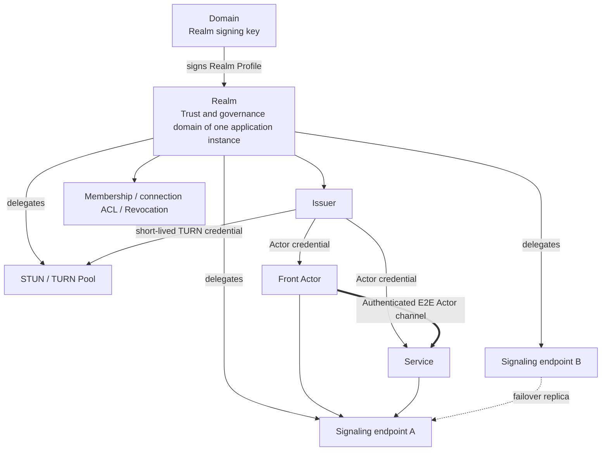

# 07. Realm, Signaling, TURN and Identity

## 1. A picture of the relationship



Conclusions:

- A Realm corresponds to one application instance: creating an application instance creates a Realm;
- A Realm is named by "RealmId + Realm domain"; one domain can hold many Realms;
- A Realm is usually tightly bound to signaling, but the binding is "trust and configuration delegation," not "one Realm equals one signaling server";
- One Realm can delegate to multiple signaling clusters;
- One Actr Facility Provider (AFP) provides shared signaling, STUN/TURN and Issuer services for many Realms.
- A Realm is bound to one Actr Facility Provider at creation and can never switch; the machines and endpoints inside that Actr Facility Provider can be replaced without changing the Realm identity or ActorIds.

In v1, multiple signaling endpoints must belong to the same logical control plane, using shared/replicated presence, or having every Actor use the same active primary under a deterministic rule. They are replicas and failover entry points, not independent Actr Facility Providers freely federating with each other; federation across Actr Facility Providers is a later protocol.

## 2. Definition of a Realm

### 2.1 A Realm is an instance concept

A Realm is the logical trust and governance domain of one application instance. In Actrium, creating a new instance means creating a new Realm under the chosen domain. The instance's Service, the other Actors it orchestrates, and the Fronts that Attach to it all belong to this Realm. The Realm Profile's `package` pins the Service package.

A Realm does not follow the program: the same `notes.example/team-notes` created once by organization A and once by organization B yields two Realms. Nor is a Realm an organization-level membership domain: an organization runs as many Realms as it runs application instances.

A Realm is responsible for:

- Admission of this instance's members, devices and Actors;
- Allocating Actor serials;
- Issuing and renewing Actor credentials;
- Connection ACL, revocation and audit;
- Delegating trusted signaling, STUN, TURN and Issuer endpoints through its Realm Profile;
- Issuing short-lived, audience-restricted credentials for signaling and TURN.

v1 has no cross-Realm rules or federation; for cross-instance calls see [06 §6.3](06-runtime-and-protocol.md).

### 2.2 Realm name

A Realm is named by a domain. A DNS domain is already globally unique in the real world and its ownership is verifiable; a Realm uses only these two properties and does not require the domain to host any infrastructure.

```text
Realm name = <realm_id>@<domain>
Example    = k7m2q9xh@acme.com
Local      = k7m2q9xh@<installation-id>.actr.alt
```

- `domain` is a normalized DNS domain (lowercase IDNA A-label, no scheme, port, userinfo or path), using the same rules as a Publisher ID;
- For a local Realm, `domain` is `<installation-id>.actr.alt`: the `installation-id` is a 128-bit identifier generated at random at installation (26 lowercase base32 characters); per RFC 9476, `.alt` is never resolved through DNS, so Actrium only consults local records for `.actr.alt` and never sends or resolves it externally; a local Realm uses no Realm Profile (see 5.1);
- RealmId (`realm_id`) follows DNS label character rules `[a-z0-9-]`, 1..63 characters, not starting or ending with `-`; it is unique within the domain and immutable after creation;
- When Actrium creates an instance, it generates a fully random RealmId by default (e.g. `k7m2q9xh`, lowercase base32, containing no program name), and the human-readable name goes into the Realm Profile's `display_name`; the user may explicitly choose a readable `realm_id` (e.g. `notes`) on the confirmation screen. The `notes@acme.com` used throughout this document is an example of such an explicitly chosen readable name;
- The RealmId of a retired Realm is never reused: the domain owner must not reuse it, and Actr Facility Providers enforce this with Actr Facility Provider tombstones;
- A domain's Realm signing key is the long-term trust root of every Realm under it.

### 2.3 Realm, Publisher and Actr Facility Provider

| | Publisher | Realm | Actr Facility Provider |
|---|---|---|---|
| What it is | Publisher of a program | Trust domain of one application instance | Shared infrastructure |
| Identifier | Normalized DNS domain | Realm name `<realm_id>@<domain>` | Actr Facility Provider ID (the Actr Facility Provider's domain) |
| Long-term trust root | Publisher key | Realm signing key | None; it is the trust root when it holds a Realm signing key (Realms under its own domain, or delegated custody) |

Each Realm is bound to one Actr Facility Provider when it is created and can never switch. To change operators, create a new instance on the new Actr Facility Provider, migrate data at the application level, and retire the old instance.

A Publisher domain names the program (who published it); a Realm domain names the deployment (who operates it). The same package can run on `notes@acme.com` and also on `notes@foo.org`. One Actr Facility Provider (such as a Loran deployment) hosts a large number of Realms from many domains.

A Realm is not:

- A Marketplace;
- A Publisher;
- DNS itself;
- A WebSocket process or a signaling server;
- The same-named authentication string from the TURN RFC;
- A Workspace;
- An organization or user directory.

## 3. Realm signing keys and Realm Profile

Discovery and trust have two levels: each domain publishes its Realm signing key once, in its authority descriptor, and each Realm has one Realm Profile signed by a Realm signing key. The domain in a Realm name is exactly the domain without a port: the signing key for `notes@acme.com` comes from `https://acme.com/.well-known/actr`, and one domain can hold many Realms (see [Actr URI](../../../actr/protocols/uri.md)).

### 3.1 Realm signing key

```text
GET https://<domain>/.well-known/actr
```

It is not a separate file; it is two items in the authority descriptor, already defined in [Actr Authority Discovery](../../../actr/protocols/authority-discovery.md) §4.3–4.4:

- Optional member `realm_signing_keys`: the current and historical Realm signing keys and key ids, the rotation signature chain, a monotonic `sequence`, and an overall `signature`;
- Core relation `realms`, protocol `actr-realm-profile/1`: its `href` points to the Realm Profile service.

`realm_signing_keys.signature` is made by an `active` key over the RFC 8785 JCS canonical form of the member with `signature` removed; it covers `sequence` and provides rollback protection once the key is pinned. The rest of the authority descriptor remains an unsigned public document.

Rules:

- Fetching, HTTPS, authority binding checks, redirects and size limits follow Authority Discovery; no sub-path under `/.well-known/actr` may be used;
- Published once per domain; creating further Realms under the domain afterward requires no change to the domain;
- First trust comes from Web PKI or an enterprise-provisioned key pin; a signature inside the descriptor cannot vouch for the first root;
- On Realm signing key rotation, the old key signs `{from, to, public_key, sequence}` to form a rotation chain; a key change without a valid rotation chain is treated as an identity change and requires trust to be reconfirmed;
- Removing a key from `keys` revokes everything it signed: clients and Actr Facility Providers refresh `realm_signing_keys` on the same cadence as they refresh Realm Profiles, and when the signing key of an accepted Realm Profile has been removed, they discard that Realm Profile and its `sequence` baseline and fall back to the last Realm Profile signed by a key still listed (or fetch again if there is none);
- The `signaling`, `identity`, `ice-config` and similar services in the descriptor serve that authority itself and have nothing to do with the Realms under the domain; a Realm is reached only through the Actr Facility Provider named in its Realm Profile. When the Realm Profile cannot be fetched, fails verification, or is retired, the client must not use any other Actr Facility Provider to communicate with that Realm;
- The descriptor does not list Realms, so instances cannot be enumerated.

### 3.2 Realm Profile

Location:

```text
GET <realms href>/<realm_id>
```

The `realms` `href` may point to the domain's own static hosting (e.g. `https://acme.com/actr/realms`) or to an Actr Facility Provider (e.g. `https://realms.provider.example/acme.com`, explicit port allowed); a Realm Profile may also be embedded in an invitation. A Realm Profile's validity depends only on the Realm signing key's signature, not on where it was fetched from; an Actr Facility Provider can therefore host Realm Profiles without becoming a trust root.

A Realm Profile contains at least:

- schema (`actr.realm/v1`);
- `realm.name` (the full Realm name) and a display name;
- `status`: `active` or `retired`;
- An `active` Realm must declare `package` with the Service archive's download address, SHA-256, and Actor type.
- a monotonic `sequence` and issue time `issued_at` (a Realm Profile does not expire);
- the issuer URL and Realm issuer keys/key ids (the Actor credential's issuer is the Realm name);
- the Actr Facility Provider ID, signaling endpoints, STUN/TURN endpoints;
- the credential audience;
- the join policy (`policy`);
- the Realm signing key signature.

A Realm Profile uses an RFC 8785 JCS canonical payload with a detached Ed25519 signature; the signing key must be an `active` Realm signing key, and an existing Realm Profile signed by a key that is later retired stays valid until a higher `sequence` supersedes it. A Realm Profile does not expire; rollback protection relies only on each Realm's monotonic `sequence` (Realm Profiles with the same `sequence` must be identical). Clients refresh from the `realms` location when establishing a session, or at least every 24 hours. `provider.id` is immutable for the Realm's lifetime; a client rejects a new Realm Profile whose `provider.id` differs from the one already accepted. It contains only non-secret information.

Lifecycle:

- Creation and activation: a Realm management request is `POST`ed to the `realm-management` link of the Actr Facility Provider's own authority descriptor (`https://<provider_id>/.well-known/actr`). `create_realm` requests that the Actr Facility Provider create a pending Realm, and the response returns a Realm Profile payload to sign; the Realm signing key holder signs it and submits it with `publish_profile`, whose response is the activation response and returns an owner invite once (see 7.4; a Realm under the Actr Facility Provider's own domain is created by that Actr Facility Provider's operator, who self-signs and activates it internally and receives the owner invite at creation). The Actr Facility Provider's idempotency key is `(realm, requester)`: a retry by the same requester on its own pending or active Realm returns its state (without an owner invite); a different requester hitting a Realm of the same name, or any request hitting an Actr Facility Provider tombstone, is always a conflict; a repeated `publish_profile` returns a conflict, and a lost or expired owner invite is reissued with `reissue_owner_invite`;
- Update: under the same Actr Facility Provider, upgrading the program (`package`), rotating the Realm issuer key, changing endpoints, or changing `display_name` or the join policy all publish a new Realm Profile with a higher Realm Profile sequence;
- Retirement: retirement has only one path — the Realm signing key holder publishes a retired Realm Profile with `status = retired` (same `provider.id`, higher sequence), which stays valid forever; the Actr Facility Provider learns of it through periodic refresh and writes an Actr Facility Provider tombstone; if the Actr Facility Provider has shut down, the domain owner points the `realms` href at a storage location it controls and publishes the retired Realm Profile there; when the domain itself belongs to an Actr Facility Provider that has shut down, the Realms under it cannot be retired and can only be rebuilt elsewhere;
- If every Realm signing key is lost and no usable rotation chain exists, no existing Realm under that Realm domain can get a further Realm Profile. The domain owner can only publish a new Realm signing key (clients treat this as an identity change and must reconfirm trust) and rebuild the instances under new RealmIds.

Creation authorization: no domain, no Realm (except the local Realm). The owner of each Realm domain is the Realm signing key holder and may delegate custody of the key to an Actr Facility Provider; creating, activating and reissuing an owner invite all require the holder's authorization.

Actrium tells the two paths apart by a single decidable condition: comparing normalized A-labels, the Realm domain equals the Actr Facility Provider ID, or ends with `"." + Actr Facility Provider ID` (on a label boundary) — that is "a Realm under an Actr Facility Provider's domain."

- Local Realm: Actrium creates it directly on the local machine, with no Realm management request and no Realm Profile;
- A Realm under an Actr Facility Provider's domain: in v1 only that Actr Facility Provider's operator creates it (without Realm management requests); the operator hands the owner invite to the user out of band, and after redeeming it in Actrium the user becomes the owner and creates the Service in that Realm. The trust root is shown as that Actr Facility Provider. Self-service creation by users with Actr Facility Provider accounts (OAuth 2.0 + PKCE), with quotas per account, is a later capability;
- Any other Realm domain: the Realm signing key holder's signing service issues an Actr management envelope (bound to `provider_id`, valid for at most 5 minutes, with a nonce against replay); how the holder authenticates its own members is up to the holder. The confirmation page shows the Realm domain as the trust root.

When a domain owner delegates custody of its Realm signing key to an Actr Facility Provider, nothing in the public documents states this, and Actrium still shows the Realm domain as the trust root; the delegated Actr Facility Provider provides the signing service as the holder. Such custody is invisible to users; this is an accepted limitation.

A restricted "creation delegation key" issued by a Realm signing key (limited by RealmId prefix, quota and validity) is a later capability.

### 3.3 How an ActorId carries a Realm

An ActorId carries its Realm name, containing only the Actor serial and the Realm name:

```text
<serial>.<realm_id>@<domain>
2af01.notes@acme.com
2af01.h3x8p2wq@<installation-id>.actr.alt
```

An ActorId is like a process ID: it only answers "which Actor in which Realm." The program identity (the Actor type `publisher/program@version`) is not in the ActorId; it is carried by registration and the Actor credential, and connection ACLs and service discovery use the type from there. A Publisher changing its domain or a program upgrading never changes the ActorId format.

An old `ActrId` that only contains a `u32` and embeds the type is treated as legacy; importing it requires explicitly supplying the Realm name and rewriting it into the v1 canonical form, never guessing.

## 4. The power boundaries of the signaling server

### 4.1 It is not "purely a public good with no real power"

Even though signaling does not carry application plaintext, it can still:

- Observe ActorIds, IPs, online times and connection relationships;
- Decide who can register, discover and exchange negotiation information;
- Delay, drop, partition, throttle or ban;
- Return malicious/incorrect ICE candidates;
- Force more traffic onto TURN;
- Perform traffic correlation;
- Cause a denial of service.

Signaling is therefore an important control plane and metadata processor and must be included in the threat model.

### 4.2 Power it should not have

With correct design, signaling should not be able to:

- Forge an arbitrary Actor identity;
- Decrypt Actor application messages;
- Modify an authenticated offer/answer without being detected;
- Issue an arbitrary Actor credential;
- Obtain a Workspace capability;
- Use an ActorId to bypass application permissions.

These boundaries depend on:

- Realm-signed Actor credentials;
- The Actor's long-term key;
- Mutual challenges;
- Signature binding of SDP/ICE and the session nonce;
- DTLS/SRTP/DataChannel end-to-end protection;
- Re-authorization at the Service layer.

### 4.3 Signaling's responsibilities

- Online presence;
- Temporary mapping from ActorId to the current connection;
- Type discovery and candidate ranking;
- WebRTC offer/answer/ICE exchange;
- Initial connection ACL screening;
- Actr Facility Provider failover;
- Network status events.

It is not responsible for storing Service business state.

## 5. Does Actrium have built-in signaling

Actrium has built in:

- An Actr signaling client;
- A Realm signing key and Realm Profile resolver;
- An Issuer/credential client;
- STUN/TURN configuration and failover;
- Loopback/embedded signaling for the local Realm;
- Diagnostic and status UI.

Actrium does not hard-code:

- A single global signaling server;
- A single public-interest organization;
- A single TURN;
- A Publisher's own signaling address;
- A static TURN password.

### 5.1 Local Realm

A local instance's Realm name uses the local pseudo-domain `<installation-id>.actr.alt`, one local Realm per local instance. A local Realm has no Actr Facility Provider and uses no Realm Profile or Realm management request; Actrium keeps only a local record. For a local Front and a local Service:

- Prefer in-process/loopback transport;
- Embedded signaling handles only the local Realm;
- No public STUN/TURN is needed;
- Available offline;
- The ActorId is still a persistent identity, of the form `2af01.h3x8p2wq@<installation-id>.actr.alt`;
- Only the same installation can resolve that Realm;
- "Copy link" must be disabled; moving under a domain creates a new Realm and issues a new ActorId.

### 5.2 Networked Realm

A networked instance's Realm lives under a domain:

- The user or an administrator first trusts the Realm domain (confirms it once and pins its Realm signing key);
- When the instance is created, Actrium creates a new Realm under that domain; the instance's creator is the Realm's only owner;
- Other users join this instance's Realm through a Realm invitation and obtain Realm membership;
- The Actor runtime uses the Actr Facility Provider named in the Realm Profile, which stays the same for the Realm's lifetime;
- Updates to the Realm Profile and to `realm_signing_keys` must both verify signatures, the rotation chain, and `sequence`.

## 6. Actor identity

### 6.1 Identity material

A Service's identity consists of at least:

```text
ActorId
+ Actor long-term public key
+ Realm-signed Actor credential/certificate
+ private key proof
```

A Realm client key is the key one member's client installation uses in one Realm: it is generated independently per Realm (how Actrium generates it internally is not specified elsewhere), never reused across Realms, so a single client can be revoked on its own, and different instances cannot correlate the same client through it. The principal/client binding in an Actor credential is the member id and the id of this Realm client key.

Credential claims should include:

- ActorId;
- Realm;
- Actor type;
- actor public key;
- principal/client binding (member id, Realm client key id);
- issuer/key id;
- issued/expiry;
- audience;
- role (owner/editor/viewer, as at issuance);
- revocation handle.

An optional managed-client attestation separately includes:

- platform app attestation;
- Actrium release signature/version;
- device management claim;
- attestation nonce and validity period.

Without this attestation, an Actor credential does not prove that the device is running an official Front Host (how applications should respond is covered in [Application Development Guidance](app-development-guidance.md)).

### 6.2 Persistent ActorId

A Service's long-term private key and ActorId are generated/issued once and persisted in the creation transaction.

The following operations must preserve the ActorId:

- Actrium/Service process restart;
- Normal Actor credential renewal;
- Re-authentication after losing the Actor credential's renewal token, as long as the same long-term key can be proven;
- Signaling reconnect;
- Endpoint/IP change;
- Switching between P2P and TURN;
- Migrating hosts within the Realm.

The following operations produce a new ActorId:

- Creating a new Service;
- Upgrading a Service to a new Program Release (the new Service is still created in the same Realm; membership and application permissions carry over);
- Migrating to another Realm (including from the local Realm to a Realm under a domain);
- The long-term key being revoked and unrecoverable;
- An explicit clone/fork (always creates a new Realm).

Actr's current hard rebind may return a new ID. Before v1, a protocol for "reclaiming the original ActorId with the long-term key" must be added, along with persisted identity/renewal state.

### 6.3 ID allocation

A Realm must guarantee that an Actor serial is never reused within that Realm:

- Use a Realm allocator with a uniqueness constraint;
- Or use a sufficiently strong key-derived/random ID with collision checking;
- Must not rely on a weak worker id derived from a hostname/PID hash and claim unconditional uniqueness;
- After an Actor is revoked, the Actr Facility Provider keeps its Actor serial permanently and never reallocates it;
- A Realm is permanently bound to its Actr Facility Provider, so Actor serials are always allocated by the same Actr Facility Provider.

### 6.4 Actr Host evidence identity

When the Actr Host provides evidence for a workload's egress closure, it must use an independent, verifiable Actr Host evidence key:

- For a local Realm, the Actr Host key is bound only to the current installation and is trusted only by that installation;
- A networked Realm may bind the Actr Host key to the Realm client key;
- A managed scenario may further bind platform/runtime attestation;
- Revoking an Actr Host evidence key must immediately invalidate any unexpired conclusion that relies on that key;
- The Actr Host must not self-sign its own final `ActorAssurance`;
- An Actor's own long-term key cannot impersonate an Actr Host evidence key;
- Signaling may only forward a summary of a conclusion; it may not issue a workload kind, egress closure or graph-integrity claim.

A remote verifier decides according to its own policy whether to trust that Actr Host's evidence. Without an accepted `ActorAssurance`, the identity may still be authentic, but the node conclusion must not be `CONTROLLED`.

## 7. Authentication flow

### 7.1 Trusting a domain and joining an instance's Realm

Trusting a domain (once per domain):

1. Fetch `https://<domain>/.well-known/actr` per Authority Discovery and read `realm_signing_keys`;
2. The user or an administrator confirms the Realm domain;
3. Actrium pins its Realm signing key and creates a domain record.

Joining an instance's Realm (once per instance):

1. Obtain the Realm name from a Realm invitation or a Realm link; a Realm invitation may embed the Realm Profile;
2. Fetch the Realm Profile and verify the Realm signing key signature, `sequence` and `status`;
3. The client generates a Realm client key specific to this Realm and signs the redemption of the Realm invitation with it (the signature is the proof of possession);
4. In one transaction the Actr Facility Provider consumes the invitation, creates the member (or adds a client to an existing member) as the invitation says, and registers that Realm client key, which completes client registration and grants Realm membership; no separate membership credential is issued;
5. OS secure storage keeps the Realm client key;
6. Actrium creates the Realm record.

Afterward, every request to register, reissue or renew an Actor credential is signed with the Realm client key to prove possession; the Issuer issues only for Realm client keys that are registered, not revoked, and belong to an active member. The effects of revocation are in 7.4. The protocol is [Actr Realm Membership](../../../actr/protocols/realm-membership.md).

Joining a Realm applies only to that one instance; when a user uses several instances, Actrium performs client registration for each Realm automatically, with a different Realm client key per Realm. Domain-level SSO/directories are a later capability, not part of v1.

Membership and instance authorization are two separate layers: Realm membership only decides whether one can enter the instance's network, i.e. it is the prerequisite for obtaining an Actor credential, connecting to signaling, and performing the Attach handshake; roles and permissions inside the instance (read/write, administration, sharing) are application permissions, decided by the application and session authorization, where the member role (owner/editor/viewer) is kept by the Actr Facility Provider with the member record, written into the Actor credential, and enforced by the Service; the Actr runtime decides who can discover and connect to whom by Actor type, which is called the connection ACL. The two are never merged even though they belong to the same instance; obtaining membership grants no application permission.

### 7.2 Actor registration

1. The Actr Host generates or reads the Actor's long-term key;
2. It requests a new ActorId or reclaims an existing ActorId;
3. The Issuer verifies that the request is signed by a registered, unrevoked Realm client key (Realm membership), the Actor type and allowed claims; Actors of the instance's program (the publisher and program name of `package.type`, in any version) are registered only from the owner's clients; it additionally verifies platform attestation when a managed runtime is required;
4. The Issuer issues a short-lived Actor credential carrying the ActorId, the Actor type, the member id, the Realm client key id and the role;
5. The Actor uses the short-lived ticket to connect to signaling;
6. Signaling verifies the issuer, audience, ActorId and proof.

### 7.3 Peer handshake

1. Signaling exchanges signed negotiation data;
2. WebRTC/transport is established;
3. Both sides verify the Actor credential and Actor key; independent runtime attestation is verified additionally when required;
4. A challenge/nonce prevents replay;
5. Front–Service Attach re-verifies the Program digest and the session's application permissions;
6. Only after success does the Guest capability become available.

### 7.4 Members, roles and revocation

Each networked Realm has exactly one owner: the instance's creator, who holds both the right to manage the Realm's members and the application owner role. A member signs member management requests with its own Realm client key and sends them to the Issuer named by the Realm Profile:

- Invitations: the owner issues new-member invitations (role editor or viewer, with an expiry); a member may issue an "add a client" invitation for itself, and the owner may issue one for any member. Invitations are one-time, expire, can be revoked by their issuer before redemption, travel only out of band, and never go into an `actr://` URI.
- Client revocation: a member revokes its own clients; the owner may revoke any client.
- Removing a member: owner only; it also revokes all of that member's Realm client keys.
- Changing a role: owner only; it changes only application permissions and revokes no key; it takes effect in the member's next Actor credential.
- Transferring ownership: atomic; the previous owner becomes an editor by default. The owner must transfer before leaving and cannot revoke its own last client.
- Leaving a Realm: a member removes itself, with the same effect as removal.
- Updates and retirement: for an instance under the Actr Facility Provider's domain the owner sends `update_realm` and the Actr Facility Provider signs the new or retired Realm Profile; other Realms go through the Realm signing key holder.
- Owner recovery: when the owner has lost all its clients, the Realm signing key holder (`reissue_owner_invite`) or the Actr Facility Provider's operator issues a new owner invite; redeeming it adds a new client to the owner and revokes all of the owner's previous Realm client keys.

Once a Realm client key is revoked, the Actr Facility Provider immediately refuses its new requests and new Actor credentials, revokes the unused invites it issued, disables every Actor bound to it and closes those Actors' signaling connections and TURN allocations; the same member can reissue with another of its unrevoked keys and the Actor private key to move an Actor over (FR-NET-006), while a removed member cannot; Actor credentials already issued stop working outside the Actr Facility Provider (for example where a Service checks a Front) when they expire (at most 1 hour by default on Loran). A Service treats the Front credential's expiry as the limit of an Attach session and reads the role again when the Front presents a renewed credential.

## 8. Signaling authentication credentials

Authentication material must not be placed in a long-lived URL query:

- The query gets recorded by proxies, logs, browser history and monitoring systems;
- Even a signature may retain replay value during its validity period.

Target scheme:

- A WebSocket `Authorization` header; or
- A one-time, very short-lived signaling ticket issued by the Issuer;
- The ticket binds the ActorId, endpoint audience, nonce and expiry;
- It is invalidated immediately after a successful connection;
- Logs record only the ticket's key id, never its value.

The `actr://` URI never carries a signaling ticket.

## 9. STUN/TURN

### 9.1 Two "Realms" are not the same thing

- **Actr Realm**: the product identity and governance domain.
- **TURN REALM**: the authentication realm string in the TURN long-term credential algorithm.

They may use the same domain name for operational convenience, but their protocol meanings differ and the same type must not be reused for both in code or documentation.

Suggested naming:

```text
ActrRealmId
TurnAuthRealm
```

### 9.2 TURN credentials

Must be:

- Short-lived;
- Bound to an Actor/session or principal;
- Bound to a TURN pool audience;
- Subject to expiry, bandwidth and concurrent-allocation quotas;
- Issued by that Realm's Issuer or a credential broker it authorizes;
- Support key id and rotation;
- Not use a single long-term shared secret across all Realms;
- Not allow anonymous open relaying.

### 9.3 TURN's power

TURN usually cannot see DTLS/SRTP/DataChannel plaintext, but it can see:

- Both endpoints' IPs;
- Timing, traffic volume and duration;
- Allocations;
- Relay relationships.

It can also drop packets, throttle, refuse or log traffic. A Realm must therefore be explicit about its TURN Actr Facility Provider and its privacy policy.

## 10. Actr Facility Provider delegation and failover

A Realm Profile can declare multiple endpoints:

```json
{
  "signaling": [
    {"url": "wss://signal-a.realm.example:443/ws", "priority": 10},
    {"url": "wss://signal-b.provider.example:8443/ws", "priority": 20}
  ],
  "ice": [
    {"urls": ["stun:stun.realm.example:3478"]},
    {"urls": ["turns:turn.provider.example:5349"], "credential_audience": "turn-pool-1"}
  ]
}
```

Rules:

- Endpoint domains may differ from the domain in the Realm name;
- A Realm Profile signed by the Realm signing key constitutes the delegation authorization;
- Where the Realm Profile is stored does not affect its validity;
- Non-default ports are allowed;
- Switching endpoints never changes the Realm or the ActorId;
- Failover cannot jump to an undeclared Actr Facility Provider;
- The Actr Facility Provider's certificate and the ticket audience must match.

## 11. Port policy

| Scenario | Port policy |
|---|---|
| `actr://` URI (Realm link) | No port allowed |
| Publisher Profile bootstrap | Fixed at the Publisher domain's HTTPS 443 |
| `package.href`, Issuer in the Realm Profile | Explicit port allowed, must be HTTPS |
| Realm signing key (authority descriptor `/.well-known/actr`) | Fixed at the Realm domain's HTTPS 443 |
| Realm Profile | The HTTPS location declared by the `realms` relation, explicit port allowed |
| Signaling WSS | Explicit port allowed |
| STUN/TURN | Explicit port per protocol |
| localhost/private CA | Only under explicit development/enterprise policy |

This preserves deployment freedom without making the network port part of the product identity.

## 12. Chains of trust

| Chain of trust | Root | What it verifies | On failure |
|---|---|---|---|
| Publisher/Package | DNS/TLS + Publisher key | Package bytes/digest | Do not load the program |
| Realm/Actor | DNS/TLS + Realm signing key in the authority descriptor → Realm Profile → Realm issuer key; Actor key | Peer identity/admission | Do not connect the Actor |
| Front Session | Service policy + challenge | The current Front/user/lease | Do not open business RPC |
| Signaling/TURN | Delegation via a Realm Profile signed with a Realm signing key | Control plane and relay resources | Switch or go offline |
| Marketplace | Marketplace signature/policy | Review and revocation information | Lower trust/block installation |

No single chain can substitute for another.

## 13. Offline and disconnection

### 13.1 Local Realm

- Can run offline once installed with a fixed digest;
- A local Actor credential can be recovered by Actrium's embedded issuer;
- Loopback needs no TURN;
- Revocation affects only local management.

### 13.2 Networked Realm

When the Realm Profile, credentials or revocation information are unreachable:

- An already-established short-lived session can continue until the credential expires;
- An expired identity is never extended indefinitely;
- Whether a read-only offline mode is allowed is declared by Program/Realm policy;
- A new Attach fails closed by default;
- A local replacement Service of the same type must not be created just because the Realm is unreachable.

## 14. Privacy

The metadata a Realm and its Actr Facility Provider can observe must be stated on the privacy page:

- ActorId;
- IP;
- online/offline;
- Connection targets;
- P2P/TURN;
- Timing and traffic volume.

Minimization measures:

- Do not send the Program route, Workspace name or business payload to signaling;
- Use short-lived tickets;
- Bind the offer/answer and encrypt the parts that can be encrypted;
- Minimize and shorten retention of Actr Facility Provider logs;
- Allow enterprise self-hosting;
- Support multiple Actr Facility Providers and transparent status display;
- The authority descriptor does not list Realms.

The Realm name appears in ActorIds and URLs, exposing the domain and the instance name; Actrium generates a fully random RealmId by default to avoid names being guessed or enumerated; when a user explicitly chooses a readable name, they should know it is exposed whenever it is shared.
