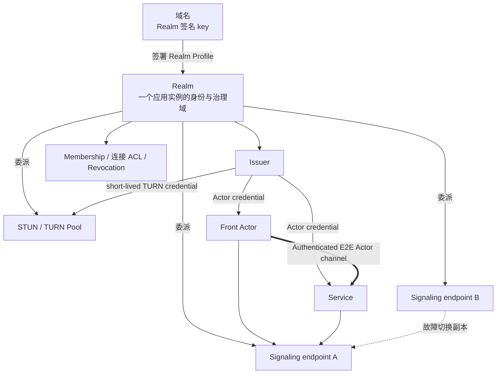

# 07. Realm、信令、TURN 与身份

## 1. 一张图看清关系



结论：

- Realm 对应一个应用实例：每创建一个应用实例，就创建一个 Realm；
- Realm 以「RealmId + Realm 域名」命名，一个域名下可以有多个 Realm；
- Realm 与信令通常强绑定，但这种绑定是「信任和配置委派」，不是「一个 Realm 等于一台信令服务器」；
- 一个 Realm 可以委派多个信令集群；
- 一个 Actr Facility Provider（AFP）提供信令、STUN/TURN、Issuer 等共享基础设施，承载大量 Realm。
- Realm 在创建时绑定一个 Actr Facility Provider，此后不可更换；同一 Actr Facility Provider 内部的机器与端点可以替换，Realm 身份和 ActorId 不变。

v1 中多个 signaling endpoint 必须属于同一个逻辑控制面，使用共享/复制的 presence，或按确定规则让所有 Actor 使用同一 active primary。它们是副本与故障切换入口，不是任意相互联邦的独立 Actr Facility Provider；跨 Actr Facility Provider federation 是后续协议。

## 2. Realm 的定义

### 2.1 Realm 是实例概念

Realm 是一个应用实例的逻辑信任和治理域。在 Actrium 中，新建实例就是在所选域名下创建一个新 Realm。
该实例的 Service、它编排的其他 Actor，以及 Attach 到它的 Front，都属于这个 Realm。
Realm Profile 的 `package` 固定 Service 包。

Realm 不跟程序走：同一个 `notes.example/team-notes` 被 A 组织创建一次、被 B 组织创建一次，就是两个 Realm。Realm 也不是组织级成员域：一个组织运营多少个应用实例，就有多少个 Realm。

Realm 负责：

- 本实例的成员、设备和 Actor 准入；
- Actor serial 分配；
- Actor credential 签发与续期；
- 连接 ACL、撤销与审计；
- 通过 Realm Profile 委派受信任的信令、STUN、TURN、Issuer 端点；
- 为信令和 TURN 颁发短期、限 audience 的凭据。

v1 不做跨 Realm 规则与 federation；跨实例调用见 [06 §6.3](06-runtime-and-protocol.md)。

### 2.2 Realm 名

Realm 以域名命名。DNS 域名在现实中已经具备全局唯一性，且归属可验证；Realm 只使用这两点，不要求域名承载任何基础设施。

```text
Realm 名 = <realm_id>@<domain>
例       = k7m2q9xh@acme.com
本机     = k7m2q9xh@<installation-id>.actr.alt
```

- `domain` 为规范化 DNS 域名（小写 IDNA A-label，无 scheme、端口、userinfo 或 path），规则与 Publisher ID 相同；
- 本机 Realm 的 `domain` 为 `<installation-id>.actr.alt`：`installation-id` 是安装时随机生成的 128 位标识（base32 小写 26 字符）；`.alt` 按 RFC 9476 永不经 DNS 解析，Actrium 见到 `.actr.alt` 只查本地记录，不对外发送、不解析；本机 Realm 不使用 Realm Profile（见 5.1）；
- RealmId（`realm_id`）使用 DNS label 的字符规则 `[a-z0-9-]`，1..63 字符，不以 `-` 开头或结尾；在域名内唯一，创建后不可修改；
- Actrium 创建实例时默认生成完全随机的 RealmId（如 `k7m2q9xh`，base32 小写，不含程序名），可读名称放在 Realm Profile 的 `display_name`；用户可在确认界面显式改用可读的 `realm_id`（如 `notes`）。本文中的 `notes@acme.com` 即显式选择可读名的例子；
- 已退役 Realm 的 RealmId 永不复用：域名所有者不得复用，Actr Facility Provider 以 Actr Facility Provider tombstone 强制；
- 域名的 Realm 签名 key 是该域名下所有 Realm 的长期信任根。

### 2.3 Realm、Publisher 与 Actr Facility Provider

| | Publisher | Realm | Actr Facility Provider |
|---|---|---|---|
| 是什么 | 程序的发布者 | 一个应用实例的信任域 | 共享基础设施 |
| 标识 | 规范化 DNS 域名 | Realm 名 `<realm_id>@<domain>` | Actr Facility Provider ID（Actr Facility Provider 的域名） |
| 长期信任根 | Publisher key | Realm 签名 key | 无；持有 Realm 签名 key 时（其域名下的 Realm，或受托代持）即为信任根 |

每个 Realm 在创建时绑定一个 Actr Facility Provider，此后不可更换。需要换运营方时，在新 Actr Facility Provider 上新建实例并做应用层数据迁移，旧实例退役。

Publisher 域名命名程序（谁发布），Realm 域名命名部署（谁运营）。同一个包可以运行在 `notes@acme.com`，也可以运行在 `notes@foo.org`。一个 Actr Facility Provider（如一套 Loran 部署）承载来自多个域名的大量 Realm。

Realm 不是：

- Marketplace；
- Publisher；
- DNS 本身；
- 一个 WebSocket 进程或一台信令服务器；
- TURN RFC 中同名的认证字符串；
- Workspace；
- 组织或用户目录。

## 3. Realm 签名 key 与 Realm Profile

发现与信任分两级：每个域名在其 authority descriptor 中发布一次 Realm 签名 key，每个 Realm 一份由 Realm 签名 key 签名的 Realm Profile。Realm 名中的域名就是不含端口的域名：`notes@acme.com` 的签名 key 取自 `https://acme.com/.well-known/actr`，一个域名下可以有多个 Realm（见 [Actr URI](../../../actr/protocols/uri.zh.md)）。

### 3.1 Realm 签名 key

```text
GET https://<domain>/.well-known/actr
```

它不是独立文件，而是 authority descriptor 中的两项内容，已在 [Actr Authority Discovery](../../../actr/protocols/authority-discovery.zh.md) §4.3–4.4 定义：

- 可选成员 `realm_signing_keys`：当前和历史 Realm 签名 key 与 key id、轮换签名链、单调 `sequence`，以及整体 `signature`；
- core relation `realms`，protocol `actr-realm-profile/1`：`href` 指向 Realm Profile 服务。

`realm_signing_keys.signature` 由某个 `active` key 对去掉 `signature` 后的该成员做 RFC 8785 JCS 规范化后签名，覆盖 `sequence`，在固定 key 之后提供回滚保护。authority descriptor 的其余部分仍是无签名的公开文档。

规则：

- 获取、HTTPS、authority 绑定校验、redirect 与大小上限均以 Authority Discovery 为准；不得使用 `/.well-known/actr` 下的任何子路径；
- 每个域名只发布一次，之后在该域名下创建 Realm 不需要再改动域名；
- 首次信任来自 Web PKI 或企业预置的 key pin；descriptor 内的签名不能自证首个 root；
- Realm 签名 key 轮换时，旧 key 签名 `{from, to, public_key, sequence}` 形成轮换链；没有有效轮换链的 key 变化按身份变化处理，必须重新确认信任；
- 从 `keys` 中移除某个 key 即吊销它签过的一切：客户端与 Actr Facility Provider 以刷新 Realm Profile 的节奏刷新 `realm_signing_keys`，已接受 Realm Profile 的签名 key 被移除时，丢弃该 Realm Profile 及其 `sequence` 基线，改用最后一份由仍列出的 key 签名的 Realm Profile（没有则重新获取）；
- descriptor 中的 `signaling`、`identity`、`ice-config` 等服务于该 authority 自身，与该域名下的 Realm 无关；访问某个 Realm 只使用其 Realm Profile 指定的 Actr Facility Provider。Realm Profile 取不到、验证失败或已退役时，客户端不得使用任何其他 Actr Facility Provider 与该 Realm 通信；
- descriptor 不列出 Realm 清单，避免实例被枚举。

### 3.2 Realm Profile

位置：

```text
GET <realms href>/<realm_id>
```

`realms` 的 `href` 可以指向域名自己的静态托管（如 `https://acme.com/actr/realms`），也可以指向 Actr Facility Provider（如 `https://realms.provider.example/acme.com`，可带显式端口）；Realm Profile 也可以随邀请内嵌。Realm Profile 的有效性只取决于 Realm 签名 key 的签名，不取决于从哪里取到；因此 Actr Facility Provider 可以托管 Realm Profile 而不成为信任根。

Realm Profile 至少包含：

- schema（`actr.realm/v1`）；
- `realm.name`（完整 Realm 名）与显示名；
- `status`：`active` 或 `retired`；
- `active` Realm 必须声明 `package`，记录 Service 包的下载地址、SHA-256 和 Actor 类型。
- 单调 `sequence` 与签发时间 `issued_at`（Realm Profile 不设过期时间）；
- issuer URL、Realm issuer keys/key ids（Actor credential 的 issuer 即 Realm 名）；
- Actr Facility Provider ID、signaling endpoints、STUN/TURN endpoints；
- credential audience；
- 加入策略（`policy`）；
- Realm 签名 key 签名。

Realm Profile 使用 RFC 8785 JCS 规范化 payload 和 detached Ed25519 签名；签名 key 必须是 `active` Realm 签名 key；由后来退役的 key 签发的既有 Realm Profile 在被更高 `sequence` 取代前仍有效。Realm Profile 不过期，回滚保护只依赖每个 Realm 的单调 `sequence`（相同 `sequence` 的内容必须完全一致）；客户端建立会话时或至少每 24 小时按 `realms` 位置刷新。`provider.id` 在 Realm 生命周期内不可变，客户端拒绝 `provider.id` 与已接受 Realm Profile 不同的新 Realm Profile。只包含非秘密信息。

生命周期：

- 创建与激活：Realm 管理请求以 `POST` 发往 Actr Facility Provider 自身 authority descriptor（`https://<provider_id>/.well-known/actr`）的 `realm-management` link。`create_realm` 请求 Actr Facility Provider 创建 pending Realm，响应返回待签 Realm Profile payload；Realm 签名 key 持有方签名后以 `publish_profile` 提交，其响应即激活响应，一次性返回 owner 邀请（见 7.4；Actr Facility Provider 域名下的 Realm 由该 Actr Facility Provider 的运营者创建，自签与激活在其内部完成，owner 邀请在创建时交给运营者）。Actr Facility Provider 幂等键为 `(realm, 请求方)`：同一请求方对自己的 pending 或 active Realm 重试返回其状态（不返回 owner 邀请）；不同请求方命中同名 Realm，或任何请求命中 Actr Facility Provider tombstone，一律冲突；重复 `publish_profile` 返回冲突，丢失或过期的 owner 邀请用 `reissue_owner_invite` 重新签发；
- 更新：同一 Actr Facility Provider 下升级程序（`package`）、轮换 Realm issuer key、变更端点、修改 `display_name` 或加入策略，均发布 Realm Profile sequence 更高的新 Realm Profile；
- 退役：退役只有一条路径，即 Realm 签名 key 持有方发布 `status = retired` 的退役 Realm Profile（保持相同 `provider.id`、sequence 更高），永久有效；Actr Facility Provider 通过周期刷新得知并写入 Actr Facility Provider tombstone；若 Actr Facility Provider 已停服，域名所有者把 `realms` href 改指自控存放位置并在那里发布退役 Realm Profile；域名本身属于已停服 Actr Facility Provider 时，其中的 Realm 无法退役，只能在别处新建；
- Realm 签名 key 全部丢失且没有可用轮换链时，该 Realm 域名下的既有 Realm 都无法再签发后续 Realm Profile。域名所有者只能发布新的 Realm 签名 key（客户端按身份变化处理、重新确认信任），并在新 RealmId 下重建实例。

创建授权：没有域名就不分配 Realm（本机 Realm 除外）。每个 Realm 域名的所有者就是 Realm 签名 key 持有方，可以委托 Actr Facility Provider 代持；创建、激活和重签 owner 邀请都必须经持有方授权。

Actrium 只凭一个可判定条件区分两条路径：在规范化 A-label 上比较，Realm 域名等于 Actr Facility Provider ID，或以 `"." + Actr Facility Provider ID` 结尾（按 label 边界），即为「Actr Facility Provider 域名下的 Realm」。

- 本机 Realm：Actrium 在本机直接创建，不涉及 Realm 管理请求与 Realm Profile；
- Actr Facility Provider 域名下的 Realm：v1 只由该 Actr Facility Provider 的运营者代建（不经 Realm 管理请求），运营者把 owner 邀请经带外渠道交给用户，用户在 Actrium 中兑换后成为 owner 并在该 Realm 中创建 Service。信任根显示为该 Actr Facility Provider。由用户以 Actr Facility Provider 账号（OAuth 2.0 + PKCE）自助创建、按账号计配额属于后续能力；
- 其他 Realm 域名：由 Realm 签名 key 持有方的签名服务签发 Actr 管理信封（绑定 `provider_id`、有效期不超过 5 分钟、nonce 防重放），持有方如何认证其成员由持有方自己决定。确认页显示信任根为该 Realm 域名。

域名所有者委托 Actr Facility Provider 代持 Realm 签名 key 时，公开文档中没有任何字段表明这一点，Actrium 仍显示信任根为该 Realm 域名；受托的 Actr Facility Provider 以持有方身份提供签名服务。这种代持对用户不可见，是已接受的限制。

由 Realm 签名 key 签发受限的「创建委派 key」（限定 RealmId 前缀、配额、有效期）属于后续能力。

### 3.3 ActorId 如何携带 Realm

ActorId 自带 Realm 名，且只包含 Actor serial 与 Realm 名：

```text
<serial>.<realm_id>@<domain>
2af01.notes@acme.com
2af01.h3x8p2wq@<installation-id>.actr.alt
```

ActorId 类似进程 ID，只回答「哪个 Realm 里的哪个 Actor」。程序身份（Actor 类型 `publisher/program@version`）不在 ActorId 中，由注册与 Actor credential 携带；连接 ACL 与服务发现使用注册/credential 中的类型。Publisher 改域名或程序升级都不会改变 ActorId 的格式。

只含 `u32` 且内嵌类型的旧 `ActrId` 视为 legacy，导入时必须显式补足 Realm 名并重写成 v1 标准形式，不能猜测。

## 4. 信令服务器的权力边界

### 4.1 它不是「纯公益、没有实权」

信令即使不承载应用明文，仍可以：

- 观察 ActorId、IP、上线时间和连接关系；
- 决定谁能注册、发现和交换协商信息；
- 延迟、丢弃、分区、限流或封禁；
- 返回恶意/错误 ICE candidate；
- 强迫更多流量走 TURN；
- 进行流量关联；
- 造成拒绝服务。

因此信令是重要控制面和元数据处理者，必须进入威胁模型。

### 4.2 它不应拥有的权力

正确设计后，信令不应能够：

- 伪造任意 Actor 身份；
- 解密 Actor 应用消息；
- 修改已认证的 offer/answer 而不被发现；
- 颁发任意 Actor credential；
- 获得 Workspace capability；
- 用 ActorId 绕过应用权限。

这些边界依赖：

- Realm-signed Actor credential；
- Actor 长期 key；
- 双方 challenge；
- SDP/ICE 与会话 nonce 的签名绑定；
- DTLS/SRTP/DataChannel E2E 保护；
- Service 层再次授权。

### 4.3 Signaling 的职责

- 在线 presence；
- ActorId 到当前连接的临时映射；
- 类型发现与候选排序；
- WebRTC offer/answer/ICE 交换；
- 连接 ACL 初筛；
- Actr Facility Provider failover；
- 网络状态事件。

它不负责保存 Service 业务状态。

## 5. Actrium 是否内置信令

Actrium 内置：

- Actr signaling client；
- Realm 签名 key 与 Realm Profile resolver；
- Issuer/credential client；
- STUN/TURN 配置和故障切换；
- 本机 Realm 的 loopback/embedded signaling；
- 诊断和状态 UI。

Actrium 不写死：

- 唯一全球信令服务器；
- 唯一公益组织；
- 唯一 TURN；
- Publisher 自己的信令地址；
- 静态 TURN 密码。

### 5.1 本机 Realm

本机实例的 Realm 名使用本机伪域名 `<installation-id>.actr.alt`，每个本机实例一个本机 Realm。本机 Realm 没有 Actr Facility Provider，不使用 Realm Profile 与 Realm 管理请求，Actrium 只保存本地 record。本机 Front 与本机 Service：

- 优先使用 in-process/loopback transport；
- embedded signaling 只处理本机 Realm；
- 不需要公网 STUN/TURN；
- 离线可用；
- ActorId 仍是持久身份，形如 `2af01.h3x8p2wq@<installation-id>.actr.alt`；
- 只有同一 installation 可以解析该 Realm；
- 「复制链接」必须禁用；迁移到域名下即创建新 Realm，并签发新 ActorId。

### 5.2 联网 Realm

联网实例的 Realm 位于某个域名下：

- 用户或管理员先信任该 Realm 域名（首次确认并固定其 Realm 签名 key）；
- 创建实例时，Actrium 在该域名下创建新 Realm，实例创建者是该 Realm 唯一的 owner；
- 其他用户通过 Realm 邀请加入这个实例的 Realm，取得 Realm membership；
- Actor 运行时使用 Realm Profile 中的 Actr Facility Provider，该 Actr Facility Provider 在 Realm 生命周期内不变；
- Realm Profile 与 `realm_signing_keys` 的更新都必须验证签名、轮换链和 `sequence`。

## 6. Actor 身份

### 6.1 身份材料

Service 的身份至少由以下组成：

```text
ActorId
+ Actor long-term public key
+ Realm-signed Actor credential/certificate
+ private key proof
```

Realm 客户端 key 是某个成员的某个客户端安装在某个 Realm 中使用的 key：每个 Realm 独立生成（Actrium 内部如何生成不对外规定），不跨 Realm 复用，可单独吊销某个客户端，不同实例也无法据此关联同一客户端。Actor credential 中的 principal/client binding 即成员 id 与该 Realm 客户端 key 的 id。

Credential claims 应包含：

- ActorId；
- Realm；
- Actor 类型；
- actor public key；
- principal/client binding（成员 id、Realm 客户端 key id）；
- issuer/key id；
- issued/expiry；
- audience；
- 角色（owner/editor/viewer，签发时的值）；
- revocation handle。

可选的受管客户端证明另行包含：

- platform app attestation；
- Actrium 发行签名/版本；
- device management claim；
- attestation nonce 和有效期。

没有这类证明时，Actor credential 不证明设备正在运行官方 Front Host（应用如何应对见[应用开发建议](app-development-guidance.zh.md)）。

### 6.2 持久 ActorId

Service 的长期私钥和 ActorId 在创建事务中一次生成/签发并持久化。

以下操作必须保持 ActorId：

- Actrium/Service 进程重启；
- Actor credential 正常续期；
- Actor credential 的 renewal token 丢失后的重新认证，只要能证明同一长期 key；
- signaling reconnect；
- endpoint/IP 变化；
- P2P 与 TURN 切换；
- Realm 内主机迁移。

以下操作产生新 ActorId：

- 创建新 Service；
- Service 升级为新 Program Release（新 Service 仍创建在同一 Realm，成员与应用权限延续）；
- 迁移到另一个 Realm（包括从本机 Realm 迁到域名下的 Realm）；
- 长期 key 被撤销且不能恢复；
- 显式 clone/fork（总是新建 Realm）。

Actr 当前 hard rebind 可能返回新 ID。v1 前必须新增「凭长期 key reclaim 原 ActorId」的协议，并持久化 identity/renewal state。

### 6.3 ID 分配

Realm 必须保证 Actor serial 在本 Realm 内永久不复用：

- 使用带唯一约束的 Realm allocator；
- 或使用足够强的 key-derived/随机 ID 并做碰撞检查；
- 不能依赖 hostname/PID 哈希的弱 worker id 就宣称无条件唯一；
- 撤销 Actor 后其 Actor serial 由 Actr Facility Provider 永久保留、不再分配；
- Realm 与 Actr Facility Provider 永久绑定，Actor serial 始终由同一 Actr Facility Provider 分配。

### 6.4 Actr Host 证据身份

Actr Host 为 workload 出口闭包提供证据时，必须使用独立、可验证的 Actr Host 证据键：

- 本机 Realm 的 Actr Host key 只绑定当前安装，只对本安装构成信任；
- 联网 Realm 可以把 Actr Host key 绑定到 Realm 客户端 key；
- 受管场景可以进一步绑定 platform/runtime attestation；
- Actr Host 证据键撤销必须使依赖该键的尚未过期结论立即失效；
- Actr Host 不得自签自己的最终 `ActorAssurance`；
- Actor 自身的长期 key 不能冒充 Actr Host 证据键；
- signaling 只能转发结论摘要，不能签发 workload kind、egress closure 或图完整性主张。

远端验证方根据自身策略决定是否信任该 Actr Host 的证据。没有被接受的 `ActorAssurance` 时，身份仍可能 authentic，但节点结论不得为 `CONTROLLED`。

## 7. 身份验证流程

### 7.1 信任域名与加入实例 Realm

信任域名（每个域名一次）：

1. 按 Authority Discovery 获取 `https://<domain>/.well-known/actr`，读取 `realm_signing_keys`；
2. 用户或管理员确认该 Realm 域名；
3. Actrium 固定其 Realm 签名 key，建立域名 record。

加入某个实例的 Realm（每个实例一次）：

1. 从 Realm 邀请或 Realm 链接得到 Realm 名；Realm 邀请可以内嵌 Realm Profile；
2. 获取 Realm Profile，验证 Realm 签名 key 签名、`sequence` 与 `status`；
3. 客户端为该 Realm 生成独立的 Realm 客户端 key，用它签名兑换 Realm 邀请（签名即持有证明）；
4. Actr Facility Provider 在同一事务中消耗邀请、按邀请建立成员（或为已有成员添加客户端）并登记该 Realm 客户端 key，即完成客户端注册，取得 Realm membership；不另发 membership 凭证；
5. OS 安全存储保存 Realm 客户端 key；
6. Actrium 建立 Realm record。

此后每次申请、重签或续期 Actor credential，客户端都用 Realm 客户端 key 签名证明持有；Issuer 只对已注册且未撤销、属于 active 成员的 Realm 客户端 key 签发。撤销的效果见 7.4。协议见 [Actr Realm Membership](../../../actr/protocols/realm-membership.zh.md)。

加入 Realm 只针对这一个实例；用户使用多个实例时，Actrium 自动完成各 Realm 的客户端注册，每个 Realm 使用不同的 Realm 客户端 key。域名级 SSO/目录属于后续能力，v1 不做。

membership 与实例授权是两层：Realm membership 只决定能否进入该实例的网络，即取得 Actor credential、连接 signaling、进行 Attach 握手的前提；实例内的角色与权限（读写、管理、分享）属于应用权限，由应用与会话授权决定，其中成员角色（owner/editor/viewer）由 Actr Facility Provider 随成员记录保存、写入 Actor credential，由 Service 执行；Actr 运行时按 Actor 类型决定谁能发现、连接谁，称为连接 ACL。两者即使同属一个实例也不合并，取得 membership 不等于获得任何实例内权限。

### 7.2 Actor 注册

1. Actr Host 生成或读取 Actor长期 key；
2. 请求新 ActorId 或 reclaim 已有 ActorId；
3. Issuer 验证请求由已登记、未撤销的 Realm 客户端 key 签名（Realm membership）、Actor 类型和允许的 claim；该实例程序（`package.type` 的 publisher 与程序名，不论版本）的 Actor 只接受 owner 的客户端注册；需要受管 runtime 时另验 platform attestation；
4. Issuer 签发短期 Actor credential，携带 ActorId、Actor 类型、成员 id、Realm 客户端 key id 与角色；
5. Actor 使用短期 ticket 连接 signaling；
6. signaling 验证 issuer、audience、ActorId 和 proof。

### 7.3 Peer handshake

1. 信令交换已签名协商数据；
2. WebRTC/transport 建立；
3. 双方验证 Actor credential 与 Actor key；需要时再验证独立 runtime attestation；
4. challenge/nonce 防止重放；
5. Front–Service Attach 再验证 Program digest 与会话的应用权限；
6. 成功后 Guest capability 才可用。

### 7.4 成员、角色与撤销

每个联网 Realm 恰好一个 owner：实例创建者，同时持有该 Realm 的成员管理权与应用 owner 角色。成员管理请求由成员用自己的 Realm 客户端 key 签名，发往 Realm Profile 所指 Issuer：

- 邀请：owner 签发新成员邀请（角色 editor 或 viewer，带过期时间）；成员可为自己签发「添加客户端」邀请，owner 可为任何成员签发。邀请一次性、可过期、签发者可在兑换前撤销，只经带外渠道交付，不进入 `actr://` URI。
- 客户端撤销：成员撤销自己的客户端，owner 可撤销任何客户端。
- 移除成员：只有 owner；同时撤销该成员的全部 Realm 客户端 key。
- 改角色：只有 owner，只改应用权限，不撤销 key；在该成员下一份 Actor credential 生效。
- 转让 owner：原子完成，原 owner 默认改为 editor。owner 离开前必须先转让，也不能撤销自己最后一个客户端。
- 离开 Realm：成员移除自己，效果同移除成员。
- 更新与退役：Actr Facility Provider 域名下的实例由 owner 发 `update_realm`，Actr Facility Provider 签署新的或退役的 Realm Profile；其他 Realm 经 Realm 签名 key 持有方。
- owner 恢复：owner 丢失全部客户端时，由 Realm 签名 key 持有方（`reissue_owner_invite`）或 Actr Facility Provider 运营者签发新的 owner 邀请；兑换后成为 owner 的新客户端，owner 原有客户端 key 全部撤销。

撤销 Realm 客户端 key 后，Actr Facility Provider 立即拒绝它的新请求与新 Actor credential，撤销它签发的未用邀请，停用绑定到它的全部 Actor 并关闭这些 Actor 的 signaling 连接与 TURN allocation；同一成员可用自己另一把未撤销的 key 凭 Actor 私钥重签，把 Actor 移过来（FR-NET-006），被移除的成员则不能；已签发的 Actor credential 在 Actr Facility Provider 之外（例如 Service 对 Front 的校验）到期失效（Loran 默认最多 1 小时）。Service 以 Front credential 的到期时间为 Attach 会话的上限，Front 续期后出示新 credential 时重新读取角色。

## 8. 信令认证凭据

认证材料不得放在长期 URL query：

- query 会被代理、日志、浏览器历史和监控系统记录；
- 即使是签名，它在有效期内也可能具有可重放价值。

目标方案：

- WebSocket `Authorization` header；或
- Issuer 签发的一次性、极短期 signaling ticket；
- ticket 绑定 ActorId、endpoint audience、nonce 和到期；
- 成功连接后立即作废；
- 日志只记录 ticket key id，不记录值。

`actr://` URI 中永远不携带 signaling ticket。

## 9. STUN/TURN

### 9.1 两个 Realm 不是一回事

- **Actr Realm**：产品身份和治理域。
- **TURN REALM**：TURN 长期凭据算法中的认证域字符串。

它们可以使用相同域名方便运维，但协议含义不同，不能在代码和文档中复用同一个类型。

建议命名：

```text
ActrRealmId
TurnAuthRealm
```

### 9.2 TURN 凭据

必须：

- 短期；
- 绑定 Actor/会话或 principal；
- 绑定 TURN pool audience；
- 有到期、带宽、并发 allocation 配额；
- 由该 Realm 的 Issuer 或其授权的 credential broker 签发；
- 支持 key id 和轮换；
- 不使用跨所有 Realm 的单一长期 shared secret；
- 不允许匿名开放中继。

### 9.3 TURN 的权力

TURN 通常看不到 DTLS/SRTP/DataChannel 明文，但可以看到：

- 两端 IP；
- 时间、流量大小和持续时间；
- allocation；
- 中继关系。

它也可以丢包、限速、拒绝或记录流量。因此 Realm 必须明确其 TURN Actr Facility Provider 和隐私政策。

## 10. Actr Facility Provider 委派与故障切换

Realm Profile 可以声明多个 endpoint：

```json
{
  "signaling": [
    {"url": "wss://signal-a.realm.example:443/ws", "priority": 10},
    {"url": "wss://signal-b.provider.example:8443/ws", "priority": 20}
  ],
  "ice": [
    {"urls": ["stun:stun.realm.example:3478"]},
    {"urls": ["turns:turn.provider.example:5349"], "credential_audience": "turn-pool-1"}
  ]
}
```

规则：

- endpoint 域名可以不同于 Realm 名中的域名；
- 由 Realm 签名 key 签署的 Realm Profile 构成委派授权；
- Realm Profile 的存放位置不影响其有效性；
- 非默认端口允许；
- endpoint 切换不改变 Realm 或 ActorId；
- failover 不能跳到未声明 Actr Facility Provider；
- Actr Facility Provider 证书和 ticket audience 必须匹配。

## 11. 端口政策

| 场景 | 端口政策 |
|---|---|
| `actr://` URI（Realm 链接） | 不允许端口 |
| Publisher Profile bootstrap | 固定 Publisher 域名的 HTTPS 443 |
| Realm Profile 的 `package.href`、Issuer | 可显式端口，必须 HTTPS |
| Realm 签名 key（authority descriptor `/.well-known/actr`） | 固定 Realm 域名的 HTTPS 443 |
| Realm Profile | `realms` relation 声明的 HTTPS 位置，可显式端口 |
| Signaling WSS | 可显式端口 |
| STUN/TURN | 按协议显式端口 |
| localhost/private CA | 仅开发/企业显式策略 |

这样既保留部署自由，又不把网络端口变成产品标识的一部分。

## 12. 信任链

| 信任链 | 根 | 验证对象 | 失败后 |
|---|---|---|---|
| Publisher/Package | DNS/TLS + Publisher key | package bytes/digest | 不加载程序 |
| Realm/Actor | DNS/TLS + authority descriptor 中的 Realm 签名 key → Realm Profile → Realm issuer key；Actor key | 对端身份/准入 | 不连接 Actor |
| Front Session | Service policy + challenge | 当前 Front/用户/lease | 不开放业务 RPC |
| Signaling/TURN | Realm 签名 key 签署的 Realm Profile 委派 | 控制面与中继资源 | 切换或离线 |
| Marketplace | 市场签名/策略 | 审核与撤销信息 | 降低信任/阻止安装 |

任何一条链都不能替代其他链。

## 13. Offline 与失联

### 13.1 本机 Realm

- 已安装固定 digest 可离线运行；
- 本机 Actor credential 可以由 Actrium 内嵌 issuer 恢复；
- loopback 不需要 TURN；
- 撤销只影响本机管理。

### 13.2 联网 Realm

Realm Profile、credential 或撤销信息不可达时：

- 已建立短期 session 可持续到 credential 到期；
- 不无限延长过期身份；
- 只读离线模式是否允许由 Program/Realm policy 声明；
- 新 Attach 默认失败关闭；
- 不能因为 Realm 失联创建同类型本地替代 Service。

## 14. 隐私

Realm 与 Actr Facility Provider 可以观察的元数据必须在隐私页说明：

- ActorId；
- IP；
- online/offline；
- 连接目标；
- P2P/TURN；
- 时间与流量规模。

最小化措施：

- 不把 Program route、Workspace 名或业务 payload发给信令；
- 使用短期 ticket；
- offer/answer 绑定并加密可加密部分；
- Actr Facility Provider 日志最小化和短保留；
- 允许企业自托管；
- 支持多个 Actr Facility Provider 和透明状态显示；
- authority descriptor 不列出 Realm 清单。

Realm 名出现在 ActorId 和 URL 中，会暴露域名与实例名；Actrium 默认生成完全随机的 RealmId，避免名字被猜测和枚举；显式选择可读名时，应知晓它会随分享暴露。
