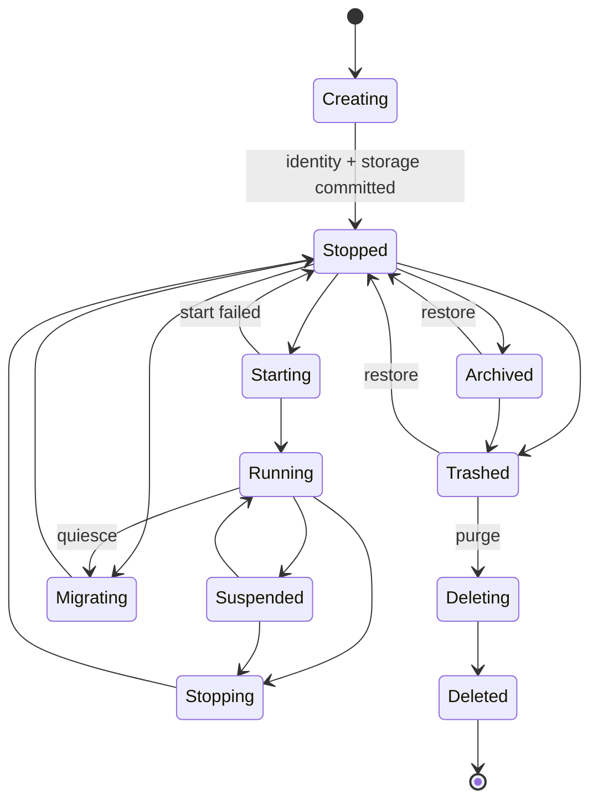

# 08. Workspace, lifecycle and local storage

## 1. Workspace belongs to the Service

Core rule:

> The Service binds the Workspace; the Front Actor only connects to the Service. Front does not need to know the Workspace's path, its Workspace Provider credential, or its lock.

This is not adding abstraction; it is unifying local files, cloud drives, databases and remote repositories into a capability the Service can hold.

## 2. WorkspaceBinding

```json
{
  "workspaceId": "ws_...",
  "displayName": "Team Notes",
  "provider": "local-folder",
  "locator": "<host-owned opaque locator>",
  "accessMode": "read-write",
  "credentialRef": "keychain://...",
  "leasePolicy": "exclusive-writer",
  "createdAt": "2026-07-29T10:00:00Z"
}
```

The launch context visible to the Guest contains only:

```json
{
  "workspace": {
    "displayName": "Team Notes",
    "mode": "read-write"
  }
}
```

It must not contain:

- the raw absolute path;
- a bookmark/security-scoped token;
- a cloud OAuth token;
- an encryption key;
- a Workspace Provider internal id (unless it is itself non-sensitive and required by the contract).

## 3. Workspace declaration

The signed Service manifest declares the following static requirements in `[workspace]`.

| Dimension | Values | Meaning |
|---|---|---|
| requirement | `none` / `optional` / `required` | whether a user Workspace is needed, and when it must be bound |
| access | `read-only` / `read-write` | the access requested by the Service |
| providers | a set of Workspace Provider types | which implementations are allowed, e.g. `managed-store`, `local-folder`, `cloud-drive` |

Omitting `[workspace]` means `requirement = "none"`. A Service can still use its private instance store.
The [package protocol](../../../actr/protocols/actor-package.zh.md#69-workspace) (Chinese) defines field validation and readiness rules.

The deployment or instance-creation flow chooses `provisioning`. With `managed`, Actrium prepares
the Workspace. With `user-selected`, the user selects and authorizes one. The actual Provider,
location, credentials, access grant, and lease are stored in the instance's Workspace binding.

Write-concurrency policy:

- `exclusive-writer`: the v1 default;
- `shared-readers`: multiple Services may read;
- `versioned-collaboration`: implemented later by the Workspace Provider/program protocol;
- when undeclared, multiple writable Services binding the same Workspace is forbidden.

## 4. Service lifecycle



This diagram only expresses the lifecycle. The Service Inventory must also separately record:

- desired state: `running`, `stopped` or `archived`;
- reachability: `online`, `offline`, `unreachable` or `unknown`;
- health: `healthy`, `degraded`, `failed` or `unknown`;
- attachment: `idle`, `leased` or `occupied`;
- placement: `local` or `remote`.

A failed start shows up as the lifecycle returning to `stopped` with health=`failed`, rather than inventing an `Error` state that is part lifecycle and part health.

### 4.1 Creating

Creation is idempotent from the user's point of view; internally it must commit in sequence via a durable saga:

- the Program Release reference;
- the Actor long-term key;
- the persistent ActorId;
- the Actor credential state;
- the per-instance data directory;
- the WorkspaceBinding;
- the permission grant;
- the Service Inventory record.

Any failure compensates the uncommitted resources; once an ActorId has actually been issued, it must not be pretended that things were "fully rolled back" — a recovery record or a local instance tombstone must be kept, and that identity must never be reused.

### 4.2 Running

- the Service accepts Attach;
- the ActorId is online;
- the Workspace lease is valid;
- the workload digest is fixed;
- runtime health is observable.

### 4.3 Stopped

- the ActorId still belongs to this Service;
- identity/key, Workspace binding and store are retained;
- signaling presence is offline;
- the local Service Manager knows it is stopped, so a local Attach can return "stopped/startable";
- remotely, only when the host control plane provides a signed status can stopped be reported; otherwise observers can only get offline/unreachable;
- the Actor itself cannot respond to requests once stopped; starting it is performed by the host control plane;
- a user with host management capability can start it on the host device.

### 4.4 Suspended

Temporarily frozen by a mobile platform or a power-saving policy:

- the running state is recoverable;
- no promise to receive real-time requests;
- lease behavior is decided by the platform and the Service's policy;
- a remote Front shows suspended, rather than creating another instance.

### 4.5 Trashed

- the Service is stopped and hidden from the default list;
- the Actor credential, long-term key, instance store, snapshots and WorkspaceBinding are retained;
- the default retention period is 30 days, adjustable by admin policy;
- restoring must return to the same ActorId;
- ordinary Attach is not allowed while trashed, but the owner may restore it or purge it early.

### 4.6 Deleted

- the Actor credential is revoked;
- a local instance tombstone (including the ActorId) is kept permanently;
- the instance store and key are deleted;
- the Workspace is not deleted by default;
- deleting the Workspace requires an independent, explicit confirmation;
- an audit record can be exported.

Deleted is the terminal state after a full purge and is not recoverable. The recovery window only belongs to Trashed; once the private key and credential are revoked, the original ActorId can no longer be promised as recoverable.

## 5. Tab and Service lifecycles are separate

| Event | Front | Service | Workspace |
|---|---|---|---|
| New Tab | create | Attach or Create | unchanged/binding created |
| Refresh | recreate | unchanged | unchanged |
| Tab backgrounded | pause/suspend | continues or platform suspend | unchanged |
| Tab closed | destroy | unchanged | unchanged |
| Front crash | destroy/recreate | unchanged | unchanged |
| Actrium restart | recreate | resumes same ActorId | unchanged |
| Service stop | detach | stopped | unchanged |
| Service trash | detach | trashed, recoverable | unchanged |
| Service purge | detach | deleted, not recoverable | retained by default |

## 6. Creation transaction

Local creation must use a durable intent:

```text
CreationIntent
├── idempotency_key
├── package_sources
├── primary_package, front_package, packages
├── service_package_digest
├── front_package_digest
├── privacy_contract_digest (when declared)
├── realm_name
├── workspace_selection
├── requested_permissions
├── stage
└── result_actor_id?
```

Stages:

```text
Prepared
→ PackageVerified
→ UserApproved
→ IdentityAllocated
→ StorageCommitted
→ ServiceStarted
→ FrontAttached
→ Completed
```

Recovery rules:

- every stage is reentrant;
- once `result_actor_id` is written, the id may not change;
- once `StorageCommitted` has happened, the instance appears in the Inventory even if the UI crashes;
- a failure never leaves behind a reusable half-identity.

## 7. Service storage

### 7.1 Directory isolation

If Actr today keys data directories only by `ActrType`, multiple Services of the same type will collide. The target layout must isolate by the stable ActorId:

```text
actrium-data/
├── programs/
│   └── sha256/<package-digest>/
├── services/
│   └── <sha256(actor-id)>/
│       ├── instance.json
│       ├── actor-store/
│       ├── workload-state/
│       ├── snapshots/
│       └── logs/
├── workspaces/
│   └── <workspace-id>/...
└── db/
    └── actrium.sqlite
```

The directory name uses a hash of the ActorId, avoiding `/`, `:`, length and case-sensitivity problems; `instance.json` stores the full canonical ActorId.

### 7.2 Secure storage

The following go only into the OS Keychain/Keystore/Credential Locker:

- the Realm client key;
- the Service's private key;
- the renewal token (used to renew the Actor credential);
- the Workspace Provider credential;
- the TURN/signaling ticket (usually memory-only);
- encryption keys.

Ordinary SQLite stores only opaque references.

### 7.3 Database tables

A suggested minimal model:

```text
program_release
  publisher, program, version, package_digest, trust_state

service
  realm_name, actor_id, actor_id_hash, publisher, program, version, service_package_digest,
  primary_package, front_package, packages, privacy_contract_digest, workspace_id, runtime_location,
  lifecycle_state, desired_state, reachability, health,
  attachment_state, placement, created_at, last_opened_at

workspace
  workspace_id, display_name, provider, locator_ref,
  credential_ref, access_mode, lease_policy

permission_grant
  subject, capability, scope, decision, granted_at, expires_at

tab_session
  tab_id, realm_link, service_actor_id, front_actor_id, state,
  structure_digest, application_state_digest, application_color, ready

privacy_mark_cache
  mark_id, subject_ref, issuer_ref, workload_kind, egress_digest,
  issued_at, expires_at, revocation_state, encrypted_blob_ref

privacy_dependency_edge
  structure_digest, application_state_digest, edge_id, source_ref, target_ref,
  data_classes, target_mark_digest, decision, opened_at, closed_at

privacy_aggregate
  assurance_digest, tab_id, structure_digest, application_state_digest, policy_digest,
  mark, weakest_actor_ref, evidence_root, generated_at, expires_at

creation_intent
  intent_id, package_source, stage, result_actor_id, timestamps

realm_domain
  domain, signing_keys, signing_keys_sequence, signing_keys_digest,
  authority_descriptor_digest

realm
  realm_name, profile_digest, profile_sequence, provider_id,
  issuer_keys, membership_ref, client_key_ref
```

An instance uses the Realm name as its business primary key (unchanged across upgrades); the current Service's ActorId is recorded as a field; `actor_id_hash` is only used for indexing and directories.

`realm_domain` records each trusted Realm domain and its Realm signing keys (the `realm_signing_keys` member from `https://<domain>/.well-known/actr`, defined in Actr Authority Discovery §4.4; `signing_keys` holds every key the domain has ever had accepted with its last state — `id`, public key and `active`, `retired` or removed; removed keys are kept too, so an `id` cannot change its public key and a removed key is never accepted again; `signing_keys_sequence` is the accepted `sequence` and `signing_keys_digest` the digest of the accepted member, which tells whether a member with the same `sequence` has the same content; after the user re-confirms an identity change these records are cleared and the new member becomes the baseline), refreshed together with the Realm Profile so that removing a key invalidates the Realm Profiles it signed; `realm` records each instance Realm, with `profile_sequence` and `provider_id` used to reject a rolled-back Realm Profile or one whose `provider.id` has changed (a local Realm has no Realm Profile, so both are empty), and `client_key_ref` points at that Realm's own Realm client key (never reused across Realms). Both are keyed by the full Realm name.

`ApplicationAssurance` is a derived conclusion for the current facet, not a permanent property of the Service. It must be recomputed after cache expiry, Tab recreation, or a state or graph change; display also requires `Ready`. Raw attestation tokens and the full remote topology are preferably kept in a short-lived encrypted cache or in memory, and must not be persisted to disk in plaintext long-term just for the UI's convenience.

## 8. Persisting the Program Catalog and Service Inventory

### The Program Catalog can be synced

- Program Release;
- digest;
- favorites;
- Marketplace metadata;
- the user's install preferences.

But other devices still need to verify and download the package themselves.

### The Service Inventory syncs cautiously

May sync:

- ActorId;
- Realm;
- Program Release;
- display name;
- remote host hints.

Must never blindly sync:

- the Actor private key;
- the Workspace credential;
- local absolute paths;
- an unprotected Workspace Provider token.

If a Service exists on only one device, the Inventory record on other devices shows "remote/host device offline," rather than trying to replicate the identity locally.

## 9. Workspace locks and leases

### 9.1 At binding time

The Actrium Workspace broker checks:

- whether the same Workspace Provider locator already has a write lease;
- whether the Workspace Provider supports multiple writers;
- whether the current Service has permission;
- symlinks, path traversal and the security scope;
- storage quota;
- the Workspace Provider's online status.

### 9.2 At runtime

- the Service only gets a brokered handle;
- all paths are relative to the Workspace root;
- atomic writes and an fsync policy;
- symlink/hardlink escape protection;
- quota;
- a write-lease heartbeat;
- lease recovery/expiry after a crash;
- Workspace Provider conflicts are clearly reported.

### 9.3 Rebinding

A Workspace must not change silently. Rebinding process:

1. stop new writes;
2. produce a consistent snapshot;
3. the user selects a new Workspace;
4. verify the new Workspace Provider;
5. migrate/import;
6. atomically switch the binding;
7. keep a rollback point;
8. resume the Service.

## 10. Snapshots, backup and restore

Snapshots have two layers:

- Service workload state;
- Workspace/Workspace Provider state.

The manifest should declare a snapshot schema version. Restoring must verify:

- the Program Release and the pinned Service package digest.
- the snapshot schema;
- the Workspace fingerprint;
- the ActorId;
- the encryption key;
- an integrity hash.

When backing up Actor identity, it is required to:

- use platform/user-protected encryption;
- prevent the same ActorId from being started on two hosts at once;
- obtain a migration/takeover lease from the Realm when restoring;
- revoke the old host's ability to run it once complete.

## 11. Service upgrade

v1 does not modify a Service's Program Release (its Actor type version) in place.

Upgrade is migration:

```text
Old Service ActorId + v1 Workspace
  → quiesce + snapshot
  → New Service ActorId + v2 workload (same Realm)
  → import/migrate
  → Workspace lease handoff
  → user verification
  → the Realm Profile's resolved primary selects the new Service archive
  → Old archived
```

Advantages:

- exact version semantics are not broken;
- the Service and Front package digests remain auditable.
- it can be rolled back;
- the old and new contracts can coexist;
- the old ActorId is never said to have become the new type.

The upgrade changes the Service's ActorId and carries over the Realm link, membership, and
application permissions. On another device, the Host verifies both archives selected by the updated Profile before attaching to the new Service.

To change any package selection, submit both references and the complete map, increase `sequence` and sign again. Identity and Workspace migration,
process shutdown and state removal require separate deployment actions.

## 12. Migrating a Service to another device

Migrating the host within the same Realm and the same Program Release can keep the ActorId. A Realm is permanently bound to its Actr Facility Provider; changing operators means creating a new instance on the new Actr Facility Provider and migrating under the rules in this section. Migrating to a different Realm (including from a local Realm to a Realm under a domain) must produce a new ActorId.

1. obtain a migration lease;
2. stop accepting new requests on the old host;
3. transfer the Actor identity, store and Workspace capability encrypted;
4. the new host proves the device and the Actor key;
5. the Realm's presence is updated;
6. the new host starts;
7. the old host destroys its copy of the key;
8. Front reconnects using the original Realm link.

If the Workspace was originally a local directory on the old device, it must be migrated separately or kept remotely accessible. That the ActorId can migrate does not mean the Workspace automatically can.

## 13. Platform constraints

### macOS / Windows

- a local Service manager can run long-term;
- a helper process can be used;
- a login item/background policy can be provided;
- the user must be able to stop all background Services.

### iOS

- a local Service is only promised to be available while Actrium is in the foreground;
- background tasks are subject to system time limits;
- continuous signaling presence is not promised;
- a long-running online instance should be hosted on a desktop, server, or supported remote host;
- Workspace security-scoped access must be correctly renewed and released.

### Android

- a foreground Service/notification can extend the available time, but must comply with platform policy;
- Doze, background restrictions and vendor policy affect online-ness;
- the user can choose "only run while in use";
- a system restriction causing a failure must not be treated as the Actor not existing.

The product UI must distinguish "Stopped," "Suspended," "Actr Host offline" and "Actor not found."

## 14. Deletion and recoverability

Deletion has two Service stages and one independent data action:

1. **Move to Trash**: stop and hide the Service, retain the Actor key, credential, instance store/snapshot and WorkspaceBinding; recoverable with the same ActorId within 30 days by default.
2. **Purge**: revoke the identity, delete the key and instance-private data, record a permanent local instance tombstone; not recoverable.
3. **Delete the Workspace**: always an independent, high-risk action, never performed by default alongside the first two steps.

Before purging, the instance-private data to be deleted, the external Workspace to be retained, and the consequences of restoring must be listed. If the Workspace's files are also explicitly deleted by the user, they should preferentially go to the Workspace Provider's/OS's trash; the audit record contains no business content.
