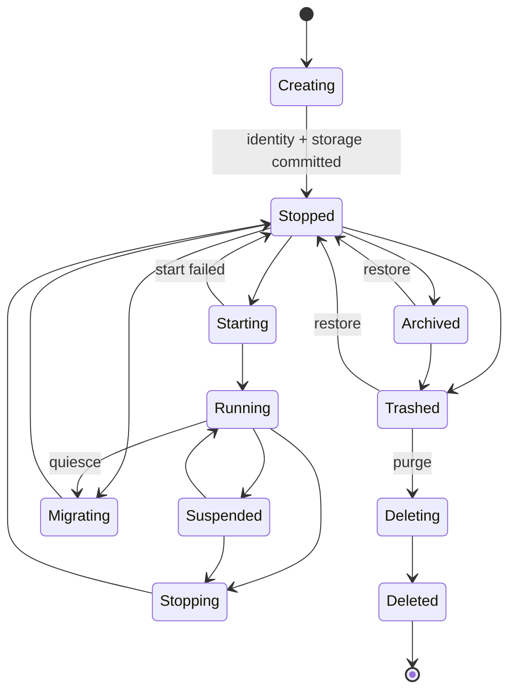

# 08. Workspace、生命周期与本地存储

## 1. Workspace 归 Service

核心规则：

> Service 绑定 Workspace，Front Actor 只连接 Service；Front 不需要知道 Workspace 的路径、Workspace Provider credential 或锁。

这不是增加抽象，而是把本地文件、云盘、数据库和远程仓库统一为 Service 可持有的 capability。

## 2. WorkspaceBinding

```json
{
  "workspaceId": "ws_...",
  "displayName": "Team Notes",
  "provider": "local-folder",
  "locator": "<host-owned opaque locator>",
  "accessMode": "read-write",
  "credentialRef": "keychain://...",
  "leasePolicy": "exclusive-writer",
  "createdAt": "2026-07-29T10:00:00Z"
}
```

Guest 可见的 launch context 只包含：

```json
{
  "workspace": {
    "displayName": "Team Notes",
    "mode": "read-write"
  }
}
```

不得包含：

- 原始绝对路径；
- bookmark/security-scoped token；
- cloud OAuth token；
- encryption key；
- Workspace Provider internal id（除非本身非敏感且契约需要）。

## 3. Workspace 声明

签名的 Service manifest 在 `[workspace]` 中声明以下静态要求。

| 维度 | 值 | 含义 |
|---|---|---|
| requirement | `none` / `optional` / `required` | 是否需要用户 Workspace，以及何时必须绑定 |
| access | `read-only` / `read-write` | Service 申请的访问能力 |
| providers | 一组 Workspace Provider 类型 | 允许 `managed-store`、`local-folder`、`cloud-drive` 等实现 |

省略 `[workspace]` 等同于 `requirement = "none"`，Service 仍可使用实例私有存储。
字段校验和就绪规则见[包协议](../../../actr/protocols/actor-package.zh.md#69-workspace)。

部署或实例创建流程选择 `provisioning`。`managed` 表示由 Actrium 准备 Workspace，
`user-selected` 表示由用户选择并授权。实际 Provider、位置、凭据、访问授权和租约
保存在实例的 Workspace 绑定中。

写入并发策略：

- `exclusive-writer`：v1 默认；
- `shared-readers`：多个 Service 可读；
- `versioned-collaboration`：未来由 Workspace Provider/程序协议实现；
- 未声明时禁止多个可写 Service 绑定同一 Workspace。

## 4. Service 生命周期



该图只表达 lifecycle。Service Inventory 还必须分别记录：

- desired state：`running`、`stopped` 或 `archived`；
- reachability：`online`、`offline`、`unreachable` 或 `unknown`；
- health：`healthy`、`degraded`、`failed` 或 `unknown`；
- attachment：`idle`、`leased` 或 `occupied`；
- placement：`local` 或 `remote`。

启动失败表现为 lifecycle 回到 `stopped` 且 health=`failed`，而不是发明一个既像生命周期又像健康度的 `Error` 状态。

### 4.1 Creating

对用户而言创建是一个幂等操作；内部必须用 durable saga 依次提交：

- Program Release reference；
- Actor long-term key；
- persistent ActorId；
- Actor credential state；
- per-instance data directory；
- WorkspaceBinding；
- permission grant；
- Service Inventory record。

任何失败都补偿未提交资源；已经成功签发 ActorId 后不能假装「完全回滚」，必须保留恢复记录或本机实例 tombstone，且不能重新使用该身份。

### 4.2 Running

- Service 接受 Attach；
- ActorId 在线；
- Workspace lease 有效；
- workload digest 固定；
- runtime health 可观测。

### 4.3 Stopped

- ActorId 仍属于该 Service；
- identity/key、Workspace binding 和 store 保留；
- signaling presence offline；
- 本地 Service Manager 知道它已停止，因此本机 Attach 可以返回「已停止/可启动」；
- 远端只有在宿主控制面提供签名状态时才能报告 stopped；否则观察者只能得到 offline/unreachable；
- Actor 自身停止后不能响应请求，启动操作由宿主控制面执行；
- 用户具备宿主管理 capability 时可以在宿主设备启动。

### 4.4 Suspended

移动平台或节能策略临时冻结：

- 运行状态可恢复；
- 不承诺接收实时请求；
- lease 行为由平台和 Service policy 决定；
- 远端 Front 显示 suspended，而不是另建实例。

### 4.5 Trashed

- Service 停止并从默认列表隐藏；
- Actor credential、长期 key、实例 store、snapshot 和 WorkspaceBinding 保留；
- 默认保留期为 30 天，可被管理员 policy 调整；
- 恢复必须回到同一 ActorId；
- 回收站期间不允许普通 Attach，但 owner 可以恢复或提前彻底清除。

### 4.6 Deleted

- 撤销 Actor credential；
- 永久保留本机实例 tombstone（含 ActorId）；
- 删除实例 store 和 key；
- Workspace 默认不删除；
- Workspace 删除需要独立、明确确认；
- 可导出审计记录。

Deleted 是彻底清除后的终态，不可恢复。恢复窗口只属于 Trashed，不能在撤销私钥和 credential 后仍承诺原 ActorId 可恢复。

## 5. Tab 与 Service 生命周期分离

| 事件 | Front | Service | Workspace |
|---|---|---|---|
| 新建 Tab | 创建 | Attach 或 Create | 不变/创建绑定 |
| 刷新 | 重建 | 不变 | 不变 |
| Tab 后台 | pause/suspend | 继续或平台 suspend | 不变 |
| Tab 关闭 | destroy | 不变 | 不变 |
| Front crash | destroy/recreate | 不变 | 不变 |
| Actrium 重启 | 重建 | 恢复同一 ActorId | 不变 |
| Service stop | detach | stopped | 不变 |
| Service trash | detach | trashed，可恢复 | 不变 |
| Service purge | detach | deleted，不可恢复 | 默认保留 |

## 6. 创建事务

本地创建必须使用 durable intent：

```text
CreationIntent
├── idempotency_key
├── package_sources
├── program_release
├── service_package_digest
├── front_package_digest
├── privacy_contract_digest (when declared)
├── realm_name
├── workspace_selection
├── requested_permissions
├── stage
└── result_actor_id?
```

阶段：

```text
Prepared
→ PackageVerified
→ UserApproved
→ IdentityAllocated
→ StorageCommitted
→ ServiceStarted
→ FrontAttached
→ Completed
```

恢复规则：

- 每一阶段可重入；
- `result_actor_id` 一旦写入不得换 ID；
- `StorageCommitted` 后即使 UI 崩溃，实例也出现在 Inventory；
- 失败不会留一个可复用的半身份。

## 7. Service 存储

### 7.1 目录隔离

当前 Actr 若只按 `ActrType` 建数据目录，会让同类型多个 Service 冲突。目标目录必须按稳定 ActorId 隔离：

```text
actrium-data/
├── programs/
│   └── sha256/<package-digest>/
├── services/
│   └── <sha256(actor-id)>/
│       ├── instance.json
│       ├── actor-store/
│       ├── workload-state/
│       ├── snapshots/
│       └── logs/
├── workspaces/
│   └── <workspace-id>/...
└── db/
    └── actrium.sqlite
```

目录名使用 ActorId hash，避免 `/`、`:`、长度和大小写问题；`instance.json` 保存完整标准 ActorId。

### 7.2 安全存储

以下内容只进入 OS Keychain/Keystore/Credential Locker：

- Realm 客户端 key；
- Service private key；
- renewal token（Actor credential 续期用）；
- Workspace Provider credential；
- TURN/signaling ticket（通常仅内存）；
- encryption keys。

普通 SQLite 只保存 opaque reference。

### 7.3 数据库表

建议最小模型：

```text
program_release
  publisher, program, version, service_package_digest, front_package_digest,
  privacy_contract_digest, release_record, trust_state

service
  realm_name, actor_id, actor_id_hash, publisher, program, version, service_package_digest,
  workspace_id, runtime_location,
  lifecycle_state, desired_state, reachability, health,
  attachment_state, placement, created_at, last_opened_at

workspace
  workspace_id, display_name, provider, locator_ref,
  credential_ref, access_mode, lease_policy

permission_grant
  subject, capability, scope, decision, granted_at, expires_at

tab_session
  tab_id, realm_link, service_actor_id, front_actor_id, state,
  structure_digest, application_state_digest, application_color, ready

privacy_mark_cache
  mark_id, subject_ref, issuer_ref, workload_kind, egress_digest,
  issued_at, expires_at, revocation_state, encrypted_blob_ref

privacy_dependency_edge
  structure_digest, application_state_digest, edge_id, source_ref, target_ref,
  data_classes, target_mark_digest, decision, opened_at, closed_at

privacy_aggregate
  assurance_digest, tab_id, structure_digest, application_state_digest, policy_digest,
  mark, weakest_actor_ref, evidence_root, generated_at, expires_at

creation_intent
  intent_id, package_source, stage, result_actor_id, timestamps

realm_domain
  domain, signing_keys, signing_keys_sequence, signing_keys_digest,
  authority_descriptor_digest

realm
  realm_name, profile_digest, profile_sequence, provider_id,
  issuer_keys, membership_ref, client_key_ref
```

实例以 Realm 名为业务主键（升级时 Realm 名不变），当前 Service 的 ActorId 作为字段记录；`actor_id_hash` 只用于索引和目录。

`realm_domain` 记录每个已信任的 Realm 域名及其 Realm 签名 key（来自 `https://<domain>/.well-known/actr` 的 `realm_signing_keys` 成员，已在 Actr Authority Discovery §4.4 定义；`signing_keys` 为该域名曾接受过的每一把 key 及其最后状态——`id`、公钥与 `active`、`retired` 或已移除；已移除的 key 也保留，使同一 `id` 不能换公钥、已移除的 key 不能再被接受；`signing_keys_sequence` 为已接受的 `sequence`，`signing_keys_digest` 为已接受 member 的摘要，用于判断同一 `sequence` 的内容是否相同；身份变化经用户重新确认后清空这些记录，以新 member 为基线），随 Realm Profile 一同刷新，以便被移除的 key 使其签过的 Realm Profile 失效；`realm` 记录每个实例 Realm，`profile_sequence` 与 `provider_id` 用于拒绝回滚或 `provider.id` 改变的 Realm Profile（本机 Realm 无 Realm Profile，两者为空），`client_key_ref` 指向该 Realm 独立的 Realm 客户端 key（不跨 Realm 复用）。两者都以完整 Realm 名为键。

`ApplicationAssurance` 是当前切面的派生结论，不是 Service 的永久属性。缓存过期、Tab 重建、状态或图变化后必须重算；展示还须 `Ready`。原始 attestation token 和完整远端拓扑优先保存在短期加密缓存或内存中，不能因便于 UI 展示而长期明文落库。

## 8. Program Catalog 与 Service Inventory 持久化

### Program Catalog 可同步

- Program Release；
- digest；
- 收藏；
- Marketplace metadata；
- 用户安装偏好。

但其他设备仍需自行验证和下载 package。

### Service Inventory 谨慎同步

可以同步：

- ActorId；
- Realm；
- Program Release；
- 显示名；
- 远端宿主提示。

不能盲目同步：

- Actor private key；
- Workspace credential；
- 本地绝对路径；
- 未保护的 Workspace Provider token。

如果 Service 只存在于一台设备，其他设备的 Inventory 记录显示「远端/宿主设备离线」，而不是尝试本地复制身份。

## 9. Workspace 锁与租约

### 9.1 绑定时

Actrium Workspace broker 检查：

- 同一 Workspace Provider locator 是否已有写 lease；
- Workspace Provider 是否支持多写；
- 当前 Service 是否具备权限；
- 符号链接、路径穿越和安全作用域；
- 存储配额；
- Workspace Provider 在线状态。

### 9.2 运行时

- Service 只拿 brokered handle；
- 所有路径相对 Workspace root；
- 原子写与 fsync policy；
- symlink/hardlink 逃逸防护；
- quota；
- write lease heartbeat；
- 崩溃后 lease 恢复/过期；
- Workspace Provider 冲突明确上报。

### 9.3 重绑

Workspace 不得静默改变。重绑流程：

1. 停止新业务写；
2. 生成一致性快照；
3. 用户选择新 Workspace；
4. 校验新 Workspace Provider；
5. 迁移/导入；
6. 原子切换 binding；
7. 保留回滚点；
8. 恢复 Service。

## 10. Snapshot、备份与恢复

Snapshot 分两层：

- Service workload state；
- Workspace/Workspace Provider state。

Manifest 应声明 snapshot schema version。恢复必须验证：

- Program Release 与固定的 Service 包摘要。
- snapshot schema；
- Workspace fingerprint；
- ActorId；
- 加密 key；
- 完整性 hash。

备份 Actor 身份时必须：

- 使用平台/用户保护的加密；
- 防止同一 ActorId 被两个宿主同时启动；
- 恢复时从 Realm 获取迁移/接管 lease；
- 完成后撤销旧宿主运行权。

## 11. Service 升级

v1 不原地修改 Service 的 Program Release（其 Actor 类型版本）。

升级是迁移：

```text
Old Service ActorId + v1 Workspace
  → quiesce + snapshot
  → New Service ActorId + v2 workload（同一 Realm）
  → import/migrate
  → Workspace lease handoff
  → user verification
  → Realm Profile 的 package 指向新 Service 包
  → Old archived
```

优点：

- 精确版本语义不破坏；
- Service 与 Front 包摘要可供审计。
- 可回滚；
- 新旧 contract 可以并存；
- 旧 ActorId 不会被说成已变成新类型。

升级会更换 Service 的 ActorId，并延续原有 Realm 链接、成员和应用权限。其他设备打开该链接时，
验证 Realm Profile 固定的新 Service 包，通过匹配的发布记录取得 Front 包，再按 Actor 类型 Attach 到新 Service。

## 12. Service 迁移设备

同 Realm、同 Program Release 的主机迁移可以保留 ActorId。Realm 与 Actr Facility Provider 永久绑定；换运营方即在新 Actr Facility Provider 上新建实例，按本节规则迁移。迁移到另一个 Realm（包括从本机 Realm 迁到域名下的 Realm）必须产生新 ActorId。

1. 获取 migration lease；
2. 停止旧宿主新请求；
3. 加密转移 Actor identity、store 和 Workspace capability；
4. 新宿主证明设备和 Actor key；
5. Realm 更新 presence；
6. 新宿主启动；
7. 旧宿主销毁密钥副本；
8. Front 用原 Realm 链接重连。

Workspace 如果本来是旧设备本地目录，必须单独迁移或保持远程可访问。ActorId 可迁移不意味着 Workspace 自动可迁移。

## 13. 平台约束

### macOS / Windows

- 可以长期运行本地 Service manager；
- 可以使用 helper process；
- 可提供登录项/后台策略；
- 用户必须能停止所有后台 Service。

### iOS

- 本地 Service 主要承诺 Actrium 前台期间可用；
- 后台任务受系统时限；
- 不承诺持续 signaling presence；
- 长期在线实例应托管在桌面、服务器或支持的远端宿主；
- Workspace security-scoped access 必须正确续用和释放。

### Android

- 前台 Service/通知可扩展可用时间，但必须符合平台政策；
- Doze、后台限制和厂商策略会影响在线性；
- 用户可选择「仅使用时运行」；
- 不以系统限制失败为 Actor 不存在。

产品 UI 必须区分「Stopped」「Suspended」「Actr Host offline」和「Actor not found」。

## 14. 删除与可恢复性

删除分为两个 Service 阶段和一个独立数据动作：

1. **移入回收站**：停止并隐藏 Service，保留 Actor key、credential、实例 store/snapshot 与 WorkspaceBinding；默认 30 天内可用同一 ActorId 恢复。
2. **彻底清除**：撤销身份，删除 key 和实例私有数据，记录永久本机实例 tombstone；不可恢复。
3. **删除 Workspace**：始终是独立的高风险动作，不随前两步默认执行。

清除前必须列出将删除的实例私有数据、将保留的外部 Workspace 和恢复后果。Workspace 文件若也被用户明确删除，应优先进入 Workspace Provider/OS 回收站；审计记录不含业务内容。
