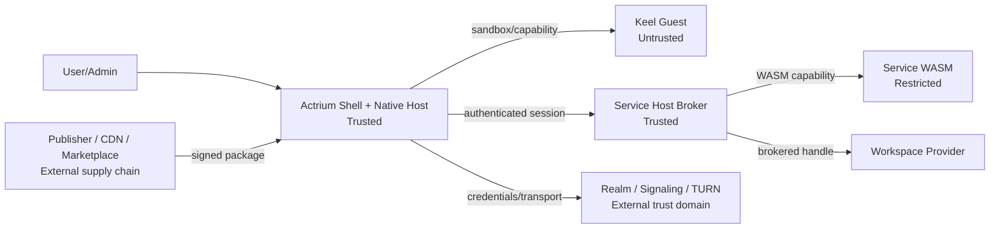

# 09. Security and privacy

> Privacy and security semantics follow [docs/security](../../architecture/security/actrium/README.zh.md). This chapter covers Actrium's threats, permissions, sandboxing and secret management; for color and graph aggregation see [13](13-privacy-state-and-aggregation.md).

## 1. Security objectives

Actrium must guarantee:

1. The user knows which Publisher the running code comes from, and which immutable version;
2. A Publisher's Guest cannot replace or extend the trusted Front Host;
3. The Guest can only use capabilities it has declared and been authorized for;
4. The Front can only send business requests to its bound Service;
5. The ActorId is proven by a cryptographic credential, not asserted verbally by a signaling server;
6. Workspace secrets, Actor keys and session secrets never enter a URI;
7. Signaling/TURN are treated as infrastructure with metadata and availability power;
8. The failure or overreach of one Program/Tab/Service should, as far as possible, not affect other instances;
9. Security limits and the real strength of isolation are represented truthfully to the user.
10. Green is shown only when, on the current ready facet, the whole graph is `Ready` and every node is `CONTROLLED`. Green is not a simultaneous whole-graph state, and it does not negate historical leaks.
11. Every network Actor edge's payload is kept confidential from signaling, TURN and ordinary relays, and is bound to the real Actor/runtime.
12. Private/secret plaintext enters only the execution, storage and compute boundary that the current policy accepts and for which the evidence is fresh.

### 1.1 Package-selection trust boundaries

The Realm signature authenticates the instance's package selection. The Host verifies each loaded
archive against its pinned digest, Publisher signature, dependency locks and local policy. Registration
of the primary program requires a valid primary reference and an owner client. Capability grants
and identity revocation follow their own authorization rules.

## 2. Trust boundary



A trusted Actr Host can still have vulnerabilities; "trusted" means it sits inside the platform's trusted computing base, not that it needs no auditing.

## 3. Assets

### High value

- Workspace content;
- Actor long-term private keys;
- Realm client keys, unused Realm invitations and renewal tokens;
- Service state and snapshots;
- Workspace Provider credentials;
- User identity and application permissions;
- package signing keys;
- Service session secrets.

### Sensitive metadata

- ActorId;
- Program/Service usage records;
- Realm membership;
- Realm name (exposes the domain and instance name);
- IP, online time, connection graph;
- Workspace display name and location;
- Permission grants;
- crash/log.

## 4. Threat actors

- A malicious or compromised Publisher;
- A tampered package/CDN/mirror;
- A malicious Keel Guest;
- A malicious Service workload;
- A malicious or compromised Marketplace;
- A malicious Realm, signaling or TURN Actr Facility Provider;
- Another process on the same device;
- An attacker with local privileges;
- A stolen device;
- A malicious link/QR code/web launch;
- Supply-chain and dependency attacks;
- Domain transfer, CA or DNS incidents.

## 5. Threats and primary controls

| Threat | Control |
|---|---|
| Different package content under the same version | Reject any archive that differs from the digest pinned for its exact Actor type or from the Realm selection. |
| CDN/cache tampering | HTTPS + package digest + Ed25519 |
| Zip slip/zip bomb | Path rejection, limits on file count/total size/compression ratio, atomic extraction |
| Guest requiring an arbitrary module | Dual allowlist at build and install time, fail-closed runtime resolver |
| Guest connecting to the network directly | No default fetch/socket; `host:net` capability + allowlist |
| Image implicitly reaching the network/carrying its own headers | ActriumSafeImage uses only an asset id or a controlled URL |
| Guest calling an arbitrary Actor | Only a fixed Service capability is exposed |
| Guest forging the user/permissions | Actr Host attaches non-overridable session metadata |
| Guest infinite loop | QuickJS interrupt timeout, destroyable runtime |
| Guest memory exhaustion | per-Guest heap cap, payload/render limits |
| Bridge/component abuse | schema and an allowlist for components/props/events/RemoteRef |
| Service escape | WASM Component, import allowlist, fuel/memory/I/O quota |
| Workspace path traversal | brokered root handle, path canonicalization, symlink policy |
| Multiple Services writing at once | exclusive writer lease |
| Bulk instance creation | User confirmation, idempotent creation intent, source rate limiting and quota |
| A link leaking permissions | Neither the Realm link nor the ActorId is a credential; the URI contains no token |
| Actor impersonation | Actor credential, Actor key proof, challenge |
| Realm invitation leak | One-time, expiring, redeemed only with a signature by a new Realm client key and consumed atomically; the issuer can revoke an unused invitation and the owner can remove anyone who got in by mistake; invitations never enter URIs |
| Lost or stolen client | A separate Realm client key per client, revocable on its own by the member or the owner; revocation immediately refuses new Actor credentials and disconnects its signaling/TURN; an owner who lost all clients recovers through an owner invite issued by the Realm signing key holder or the Actr Facility Provider's operator |
| Low-privilege member impersonating the Service or rewriting its connection ACL | Actors of the instance's program (the publisher and program name of the Realm Profile's `packages[primary_package].type`, in any version) are registered only from the owner's clients; the connection ACL carried by a registration applies only to the registering Actor's own type |
| Forging or rolling back the Realm Profile | The Realm Profile must be signed by the pinned Realm signing key; first trust goes through Web PKI or an enterprise pin; a Realm signing key change requires a valid rotation chain; `sequence` is monotonic, `provider.id` is immutable, a retired Realm is rejected; the Realm Profile never expires and the client refreshes it periodically; when the Realm Profile cannot be fetched, fails verification, or is retired, no Actr Facility Provider other than the one it specifies may be used |
| A client impersonating the official Actrium Front | The Actor credential does not prove the peer's code; the platform offers optional platform/runtime attestation |
| A malicious Actor self-reporting "no leak" | The subject being assessed must not self-sign the final `ActorAssurance`; the effective declaration is closed by the Actr Host |
| A Service concealing other Actors in the Realm | The rootless graph must discover inbound edges; a missed assessment must not be green |
| WASM's declaration differing from its actual exports | Compare the manifest, imports, effective declaration and actual edges; a confirmed undeclared export is `UNCONTROLLED` |
| Same-process Native bypassing the broker | A third-party NativeCdylib stays `UNKNOWN`, or becomes `UNCONTROLLED` once confirmed; it must not be laundered to green |
| Signaling/TURN observing or tampering with the payload | Actor Secure Envelope, bidirectional identity and transcript binding; the relay does not hold the payload key |
| A legitimate TLS termination landing at the wrong workload | Channel binding across ActorId/runtime/credential/ephemeral key/attestation result |
| A cloud admin or hypervisor reading Agent plaintext | The secret policy requires a TEE/CC; the data key is released only after remote attestation |
| A legitimate TEE attestation forwarded to a malicious instance | The Evidence is bound to a nonce, the Actor/runtime, workload digest, policy, audience and an ephemeral key |
| A CPU-only TEE while the GPU/NPU still exposes plaintext | Composite attestation across CPU+Guest+driver+IOMMU/link+device firmware/memory |
| A vendor self-reporting "confidential computing supported" | A versioned Verifier adapter, vendor trust root, Reference Values, Endorsements, TCB revocation and negative testing |
| A malicious workload inside CC actively exfiltrating | CC does not replace WASM/Native confinement, egress closure and output control |
| A legitimate Actor smuggling a secret in its response | data-class schema, declassification capability, gating on output size/destination/purpose |
| A new Actor receiving data before it is verified | A synchronous gate on the pending edge; no business payload is sent before Mark passes |
| A downstream ActorAssurance expiring while the whole stays green | `Ready` requires the current pointer; an expired one must not show green |
| Misjudging privacy after truncating a large graph | Exceeding the limit must not be truncated and then shown green |
| A configuration rollback reviving a retired old Actor Grant / old conclusion | `ActorState.revision` increases monotonically and enters the state root; a rollback gets a new `ActorStateDigest`, so the old binding never matches again |
| Disguising a peer Actor as an HTTPS sink to bypass cross-Principal scoring | An endpoint that can present an Actr identity must be assessed as an Actor target; an undecidable category stays `UNKNOWN` |
| Turning back the local clock to revive expired evidence, conclusions or credentials | Neither the enforcer's nor the assessor's clock, used for deadline/validity checks, may be turned back |
| Signaling replay | one-time ticket, nonce, short validity |
| Signaling candidate injection | signed negotiation data, peer identity handshake |
| TURN open proxy | short-lived credential, audience, quota, non-anonymous |
| Domain homograph | IDNA normalization, A-label display, risk warning |
| Domain transfer | key history, digest pin, identity-change UI |
| Local DB leak | secrets go only into Keychain/Keystore; DB minimization |
| Log leak | redaction, no credential/payload/path, retention policy |
| Front same-process sandbox escape | secure coding, fuzzing, helper-process path, risk level |

## 6. Permission model

### 6.1 Permission subject

A permission binds at least:

```text
publisher
+ program
+ major version
+ package digest or compatible release set
+ capability
+ scope
+ workspace/service
+ principal/client
```

It cannot be remembered by the program's display name alone.

### 6.2 Permission decision

States:

- `allow-once`
- `allow-while-open`
- `allow-for-service`
- `allow-for-workspace`
- `deny`
- `admin-managed`

High-risk permissions offer no permanent silent allow unless explicitly managed by organization policy.

### 6.3 Permission upgrade

If a new version:

- Adds a capability;
- Expands the domain allowlist;
- Changes from read-only to writable;
- Raises a resource quota;
- Allows a native Service;
- Changes the scope of data sharing;

then it must be reconfirmed; it cannot inherit the previous version's grant.

### 6.4 Front and Service authorized separately

For example:

```text
Front:
  clipboard.write
  notifications

Service:
  workspace.read-write
  net:https://api.example.com
  actor.call:example.com:indexer@1
```

The user can see which capability runs on the local Front and which runs on the Service host.

## 7. Keel Guest security

### 7.1 Static controls

- A package may declare only one Guest entry point;
- The bundle parser checks imports/requires;
- `eval`, the `Function` constructor and non-literal dynamic `import` are forbidden;
- The capability manifest matches the source-code analysis result;
- Limits on bundle size, source maps and character encoding;
- External source URLs are forbidden;
- Self-modifying writes to disk are forbidden.

Static scanning is a publishing diagnostic, not a complete security boundary: `Function`, indirect `eval`, alias calls and the like must also be constrained by the runtime's global policy, the module loader and capability isolation.

### 7.2 Runtime controls

- QuickJS is pinned;
- No injected `fetch`, `WebSocket`, filesystem, process or native module;
- Actr Host module dispatch is rejected unless declared;
- input/output/event schema;
- deadline, rate limit, payload limit;
- timer/callback cleanup;
- The Guest console is structured and rate-limited;
- All capability tokens are invalidated after destroy.

### 7.3 Component controls

A component prop is not automatically safe just because it looks like "ordinary UI data". Actrium must check:

- URLs and headers;
- File/asset references;
- Text and binary size;
- z-index/modal/focus behavior;
- Accessibility;
- Event frequency;
- Method calls;
- Platform-specific escape hatches.

No WebView, arbitrary HTML, arbitrary native component names or general reflection is provided by default.

## 8. Sandbox security levels

The Security Center shows the actual level:

| Level | Applies to | Isolation |
|---|---|---|
| S1 Same-process sandbox | v1 Keel JS Guest | Independent QuickJS runtime + capability + quota |
| S2 Worker/runtime isolation | Later | Can terminate the worker + independent memory scheduling |
| S3 OS process isolation | Long-term desktop goal | helper process/AppContainer/XPC |
| T1 Trusted Native | Actrium first-party/enterprise | Native workload, high trust |

S1 copy must not be written as "process-level isolation". QuickJS is a C engine; vulnerabilities in the Actr Host/Bridge/component layer can still cross the language sandbox.

## 9. Service workload security

Third-party WASM Service:

- Component Model format validation;
- import allowlist;
- No ambient filesystem/network;
- The Workspace grants only a preopened capability;
- Outbound domain, method, port policy;
- Actor dependency allowlist;
- fuel/epoch/wall timeout;
- memory/table/instance limits;
- mailbox/backpressure;
- snapshot schema;
- panic/trap terminates only that instance;
- Call auditing.

If a program requires a native Service, the install page must present it at a separate high-risk level, and the Marketplace rejects it by default.

## 10. Network and SSRF

Every URL produced by a package, Realm Profile or user input must:

- Be parsed before validation;
- Allow only the declared scheme;
- Check for loopback, private, link-local, multicast and metadata IPs, both before and after DNS resolution;
- Prevent DNS rebinding;
- Control the number of redirects and cross-origin transitions;
- Not forward sensitive headers to a new origin;
- Restrict the port;
- Limit response size and time;
- Verify the TLS hostname;
- Enterprise private-network exceptions require explicit policy authorization.

A Publisher's package endpoint may use a CDN, but a CDN URL does not automatically become part of the Guest network allowlist.

## 11. Actor/Session security

- The ActorId must be bound to a public key and an Actor credential;
- The `ActorState` revision number increases monotonically; a configuration rollback does not reproduce an old `ActorStateDigest`, and old credentials/Actor Grants do not revive;
- Credentials are short-lived and revocable;
- The Service's long-term key never leaves secure storage;
- The signaling ticket is one-time use;
- The Attach challenge is mutual;
- The session id is unpredictable;
- Session metadata is added by the Actr Host;
- Messages are rejected once the lease expires;
- The replay/idempotency-key window is well defined;
- If a Service's Actor type does not match the package the Realm Profile points to, it fails outright;
- A Service being offline does not fall back to anything else.

Platform boundary of fact: an Actor credential proves the Actor key, identity and claims, not that the peer actually runs that code; a client's declared Actor type, Actr Host version and package digest likewise do not constitute runtime attestation. For how applications should respond, see [App development guidance](app-development-guidance.md).

## 12. Workspace security

- Front/Guest has no path;
- The Service uses a brokered handle;
- The Workspace Provider credential is independent;
- Path canonicalization;
- symlink/hardlink policy;
- Atomic writes;
- quota;
- exclusive writer lease;
- High-risk deletion requires reconfirmation;
- Snapshots are encrypted;
- Dual-host use is prevented during migration;
- Deleting a Service does not delete the Workspace by default.

## 13. Secrets

Secret classification:

| Secret | Storage | Exposure scope |
|---|---|---|
| Realm client key (generated independently per Realm; how Actrium generates it internally is not externally specified) | OS secure storage | Identity Manager |
| Service key | OS secure storage | Service runtime bootstrap |
| renewal token (renews Actor credentials, bound to the Realm client key) | OS secure storage | Realm Manager |
| signaling ticket | Memory | signaling client, one-time |
| TURN credential | Memory | ICE stack, short-lived |
| Workspace credential | OS secure storage | Workspace broker |
| session secret | Front/Service Host memory | Invisible to the Guest |
| Unused Realm invitation | Out-of-band channel; invalid after one redemption | The recipient; the Actr Facility Provider stores only its hash |

Forbidden:

- URI;
- crash report;
- ordinary logs;
- Guest config;
- Clipboard;
- Unencrypted backup;
- query parameter.

## 14. Logging, diagnostics and telemetry

### Local diagnostics

May include:

- Standard error codes;
- ActorId;
- package digest;
- route name;
- timing/size;
- Realm endpoint;
- P2P/TURN status.

Excluded by default:

- RPC payload;
- User text;
- Workspace content or full paths;
- credential/ticket;
- authorization header;
- OAuth token;
- private key.

### Uploaded telemetry

- Off by default; uploaded only after the user or an organization admin explicitly enables it;
- The ActorId is salted and hashed per installation;
- A publisher's private development URI is not uploaded;
- Guest route/query content is not uploaded;
- The Workspace name is not uploaded;
- Crash dumps are redacted first;
- Retention period and purpose are stated explicitly.

## 15. Security updates and revocation

- An Actrium Host security update may require restarting the Front;
- Package revocation is handled by level;
- Revoking a Realm issuer key or Realm signing key immediately affects new connections;
- Revoking a Realm client key or removing a member immediately refuses new Actor credentials and closes its Actors' signaling connections and TURN allocations;
- An established session terminates at the latest when its credential/lease expires;
- A compromised Publisher key's historically trusted versions are judged by signing time and revocation scope;
- An emergency blocklist must be signed, expirable and auditable;
- Quarantine retains the ability to export the Workspace.

## 16. Privacy commitments

Actrium should not establish a centralized account or sync service by default. Where user data flows depends on:

- Workspace Provider;
- Service host;
- Realm;
- signaling/TURN;
- Publisher API;
- Marketplace.

The install page and the Security Center must provide a layered explanation of "where the data goes", rather than a single overall privacy switch.

The Realm name appearing in a shared Realm link exposes the Realm domain and RealmId (`realm_id`). Actrium generates a fully random RealmId for an instance by default (containing no program name or user input), with the readable name placed in `display_name`, never entering the ActorId; when a user explicitly chooses a readable RealmId, the confirmation page and the pre-share UI should warn that it will be exposed in the link. A Realm name and an ActorId resemble an email address (`k7m2q9xh@acme.com`); Actrium must not render them as a `mailto:` link, and should clearly label them as an instance address. Each Realm uses a separate Realm client key, never reused across Realms, so different instances cannot correlate the same client through it. An Actr Facility Provider and a holder's signing service know which instances they created for whom (they are the signers anyway), but the instance's members cannot see this; client names are chosen by the client and contain no personal information by default.

## 17. Security development requirements

- URI/package/manifest/ActorId parser fuzzing;
- Keel Bridge and Safe Components fuzzing;
- WASM import validation;
- archive extraction property tests;
- session replay/lease tests;
- Tests for the Realm signing key rotation chain, Realm Profile `sequence` rollback and Realm issuer key rotation;
- signaling/TURN credential leakage tests;
- capability policy differential tests;
- Multi-Tab resource isolation fault injection;
- Third-party penetration testing;
- Dependency SBOM and vulnerability scanning;
- Signing-key operations manual and incident runbook.

## 18. Application assurance

Application privacy is not a boolean field the Publisher self-reports. Actrium must handle it per [13](13-privacy-state-and-aggregation.md) and [docs/security](../../architecture/security/actrium/README.zh.md):

- The graph is rootless, formed by effective Actor `Transfer`s; the Front only locates it;
- WASM is measured by declaration + import / effective capability / egress closure;
- A third-party same-process Native must not be green; an independent Native Capsule can be promoted only if it satisfies an OS sandbox closure;
- An invalid channel blocks and does not enter the score;
- Showing green/yellow/red also requires `Ready`; a suspended state must not show green;
- A new configuration applies only to new data;
- The same assessment takes the weakest item; self-signing the final conclusion is forbidden;
- Minimal disclosure is applied to the full Actor graph; the topology is not uploaded to signaling or to default telemetry.

Green means only that the export may be controlled on the current ready facet; it does not mean the code is absolutely free of vulnerabilities.
