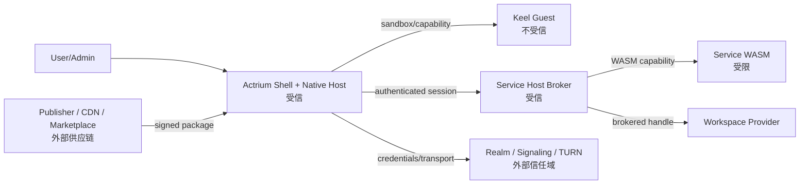

# 09. 安全与隐私

> 隐私与保障语义以 [docs/security](../../architecture/security/actrium/README.zh.md) 为准。本章写 Actrium 威胁、权限、沙箱和秘密管理；颜色与图汇聚见 [13](13-privacy-state-and-aggregation.md)。

## 1. 安全目标

Actrium 必须保证：

1. 用户知道运行的代码来自哪个 Publisher、哪个不可变版本；
2. Publisher Guest 不能替换或扩展受信 Front Host；
3. Guest 只能使用声明且授权的 capability；
4. Front 只能把业务请求发给绑定的 Service；
5. ActorId 被密码学 credential 证明，而不是信令服务器口头声明；
6. Workspace secret、Actor key 和 session secret 不进入 URI；
7. 信令/TURN 被视为有元数据与可用性权力的基础设施；
8. 一个 Program/Tab/Service 的失败或越权尽量不影响其他实例；
9. 安全限制和真实隔离强度向用户如实表达。
10. 只有当前就绪切面上整图 `Ready` 且全部节点 `CONTROLLED` 时，才展示绿色。绿色不是全图同时世界，也不否定历史泄漏。
11. 每条网络 Actor edge 的 payload 对 signaling、TURN 和普通 relay 保密，并绑定到真实 Actor/runtime。
12. private/secret 明文只进入当前 policy 接受且证据新鲜的执行、存储与算力边界。

### 1.1 包选择的信任边界

Realm 签名确认实例选用的包。Host 对每个加载的包验证 Publisher 签名，并核对整包摘要、依赖锁和本地策略。
注册主程序须有有效的主包引用和 owner 客户端身份。能力授予与身份撤销按各自的授权规则执行。

## 2. 信任边界



受信 Actr Host 仍可能有漏洞；「受信」表示它在平台可信计算基内，不表示无需审计。

## 3. 资产

### 高价值

- Workspace 内容；
- Actor 长期私钥；
- Realm 客户端 key、未用的 Realm 邀请与 renewal token；
- Service 状态与 snapshot；
- Workspace Provider credential；
- 用户身份和应用权限；
- package signing key；
- Service session secret。

### 敏感元数据

- ActorId；
- Program/Service 使用记录；
- Realm membership；
- Realm 名（暴露域名与实例名）；
- IP、在线时间、连接图；
- Workspace 显示名和位置；
- 权限授予；
- crash/log。

## 4. 威胁主体

- 恶意或被攻破的 Publisher；
- 被篡改的 package/CDN/镜像；
- 恶意 Keel Guest；
- 恶意 Service workload；
- 恶意或失陷的 Marketplace；
- 恶意 Realm、signaling 或 TURN Actr Facility Provider；
- 同设备其他进程；
- 有本机权限的攻击者；
- 被盗设备；
- 恶意链接/二维码/网页唤起；
- 供应链和依赖攻击；
- 域名过户、CA 或 DNS 事件。

## 5. 威胁与主要控制

| 威胁 | 控制 |
|---|---|
| 同版本异包 | 归档与该精确 Actor 类型已固定的摘要或 Realm 所选条目不符时拒绝。 |
| CDN/缓存篡改 | HTTPS + package digest + Ed25519 |
| Zip slip/zip bomb | 路径拒绝、文件数/总量/压缩比限制、原子解压 |
| Guest require 任意模块 | 构建与安装双重白名单、runtime resolver fail-closed |
| Guest 直接联网 | 无默认 fetch/socket；`host:net` capability + allowlist |
| Image 隐式联网/自带 header | ActriumSafeImage 只用 asset id 或受控 URL |
| Guest 调任意 Actor | 只暴露固定 Service capability |
| Guest 伪造用户/权限 | Actr Host 附加不可覆盖的 session metadata |
| Guest 无限循环 | QuickJS interrupt timeout、可销毁 runtime |
| Guest 内存耗尽 | per-Guest heap cap、payload/render limits |
| Bridge/组件滥用 | schema、组件/props/event/RemoteRef 白名单 |
| Service 逃逸 | WASM Component、import allowlist、fuel/memory/I/O quota |
| Workspace 路径穿越 | brokered root handle、路径规范化、symlink policy |
| 多 Service 同时写 | exclusive writer lease |
| 批量创建实例 | 用户确认、creation intent 幂等、来源限流和配额 |
| 链接泄露权限 | Realm 链接与 ActorId 都不是凭证，URI 不含任何 token |
| Actor 冒充 | Actor credential、Actor key proof、challenge |
| Realm 邀请泄露 | 一次性、可过期，兑换时须用新 Realm 客户端 key 签名并原子消耗；签发者可撤销未用邀请，owner 可移除误入成员；邀请不进入 URI |
| 客户端丢失或被盗 | 每个客户端独立的 Realm 客户端 key，成员或 owner 可单独撤销；撤销立即拒绝新 Actor credential 并断开其 signaling/TURN；owner 丢失全部客户端时经 Realm 签名 key 持有方或 Actr Facility Provider 运营者签发的 owner 邀请恢复 |
| 低权限成员冒充 Service 或改写其连接 ACL | 该实例程序（Realm Profile `packages[primary_package].type` 的 publisher 与程序名，不论版本）的 Actor 只接受 owner 客户端注册；注册携带的连接 ACL 只作用于所注册 Actor 自己的类型 |
| 伪造或回滚 Realm Profile | Realm Profile 必须由已固定的 Realm 签名 key 签名；首次信任经 Web PKI 或企业 pin；Realm 签名 key 变化须有有效轮换链；`sequence` 单调、`provider.id` 不可变、已退役 Realm 拒绝；Realm Profile 不过期，客户端定期刷新；取不到、验不过或已退役的 Realm Profile 时不得使用 Realm Profile 以外的任何 Actr Facility Provider |
| 客户端伪装成官方 Actrium Front | Actor credential 不证明对端代码；平台提供可选的 platform/runtime attestation |
| 恶意 Actor 自报「不泄露」 | 被评估者不得自签最终 `ActorAssurance`；有效声明由 Actr Host 闭合 |
| Service 隐瞒 Realm 内的其他 Actor | 无根图须发现入边；漏评不得绿 |
| WASM 声明与实际出口不同 | 比较 manifest、imports、有效声明和实际边；确认未声明出口则为 `UNCONTROLLED` |
| 同进程 Native 绕过 broker | 第三方 NativeCdylib 保持 `UNKNOWN` 或确认后为 `UNCONTROLLED`；不得洗绿 |
| signaling/TURN 观察或篡改 payload | Actor Secure Envelope、双向身份与 transcript 绑定；relay 不持有 payload key |
| 合法 TLS 终止到错误 workload | ActorId/runtime/credential/ephemeral key/attestation result channel binding |
| 云管理员或 Hypervisor 读取 Agent 明文 | secret policy 要求 TEE/CC；通过远程证明后才释放数据密钥 |
| 合法 TEE 证明被转发到恶意实例 | Evidence 绑定 nonce、Actor/runtime、workload digest、policy、audience 和 ephemeral key |
| 只有 CPU TEE、GPU/NPU 仍暴露明文 | CPU+Guest+driver+IOMMU/link+device firmware/memory composite attestation |
| 厂商自报「支持机密计算」 | versioned Verifier adapter、vendor trust root、Reference Values、Endorsements、TCB 撤销与负向测试 |
| CC 内恶意 workload 主动外泄 | CC 不替代 WASM/Native confinement、egress closure 与 output control |
| 合法 Actor 响应偷带 secret | data-class schema、declassification capability、输出大小/目标/用途 gate |
| 新 Actor 先收数据后验证 | pending edge 同步 gate；Mark 通过前不发送业务 payload |
| 一个下游 AA 过期但整体仍绿 | `Ready` 要求当前指针；过期不得展示绿 |
| 截断大图后误判隐私 | 超限不得截断后发绿 |
| 配置回滚复活已废除的旧 Actor Grant / 旧结论 | `ActorState.revision` 单调递增并进入状态根；回滚得到新 `ActorStateDigest`，旧绑定永久不匹配 |
| 把对端 Actor 伪装成 HTTPS 汇绕过跨 Principal 评分 | 可出示 Actr 身份的端点必须按 Actor 目标评定；类别不可判定保持 `UNKNOWN` |
| 回拨本地时钟复活过期证据、结论或凭证 | 执行方与评定方用于期限 / 有效期核对的时钟均不可回拨 |
| 信令重放 | 一次性 ticket、nonce、短有效期 |
| 信令候选注入 | 签名协商数据、peer identity handshake |
| TURN 开放代理 | 短期 credential、audience、配额、非匿名 |
| 域名同形字 | IDNA 规范化、A-label 显示、风险提示 |
| 域名过户 | key history、digest pin、identity change UI |
| 本地 DB 泄露 | secret 只进 Keychain/Keystore、DB 最小化 |
| 日志泄露 | redaction、无 credential/payload/path、保留策略 |
| Front 同进程 sandbox 逃逸 | 安全编码、fuzz、helper process 路线、风险等级 |

## 6. Permission 模型

### 6.1 权限主体

权限至少绑定：

```text
publisher
+ program
+ major version
+ package digest or compatible release set
+ capability
+ scope
+ workspace/service
+ principal/client
```

不能只按程序显示名记住。

### 6.2 权限决策

状态：

- `allow-once`
- `allow-while-open`
- `allow-for-service`
- `allow-for-workspace`
- `deny`
- `admin-managed`

高风险权限不提供永久静默允许，除非组织策略明确管理。

### 6.3 权限升级

新版本如果：

- 新增 capability；
- 扩大 domain allowlist；
- 从只读变写；
- 提高资源配额；
- 允许 Native Service；
- 改变数据共享范围；

则必须重新确认，不能继承旧版本授权。

### 6.4 Front 与 Service 分开授权

例如：

```text
Front:
  clipboard.write
  notifications

Service:
  workspace.read-write
  net:https://api.example.com
  actor.call:example.com:indexer@1
```

用户能看见哪个能力在本机前台执行，哪个在 Service 宿主执行。

## 7. Keel Guest 安全

### 7.1 静态控制

- package 只允许一个声明 Guest entry；
- bundle parser 检查 import/require；
- 禁止 eval、Function constructor 和非字面动态 import；
- capability manifest 与源码分析结果一致；
- bundle size、source map、字符编码限制；
- 禁止外部 source URL；
- 禁止自修改落盘。

静态扫描是发布诊断，不是完整安全边界：`Function`、间接 `eval`、alias 调用等必须同时由 runtime global policy、模块加载器和 capability 隔离限制。

### 7.2 运行时控制

- 固定 QuickJS；
- 不注入 fetch、WebSocket、filesystem、process、native module；
- Actr Host module dispatch 未声明即拒绝；
- input/output/event schema；
- deadline、rate limit、payload limit；
- timer/callback 清理；
- Guest console 结构化和限速；
- destroy 后所有 capability token 失效。

### 7.3 组件控制

组件 props 不是「普通 UI 数据」就自动安全。Actrium 必须检查：

- URL 和 header；
- 文件/asset reference；
- 文本与二进制大小；
- z-index/modal/focus 行为；
- accessibility；
- event 频率；
- 方法调用；
- platform-specific escape hatch。

默认不提供 WebView、任意 HTML、任意原生组件名或通用反射。

## 8. Sandbox 安全等级

安全中心显示实际等级：

| 等级 | 适用 | 隔离 |
|---|---|---|
| S1 Same-process sandbox | v1 Keel JS Guest | 独立 QuickJS runtime + capability + quota |
| S2 Worker/runtime isolation | 后续 | 可 terminate worker + 独立内存调度 |
| S3 OS process isolation | 桌面长期目标 | helper process/AppContainer/XPC |
| T1 Trusted Native | Actrium 第一方/企业 | 原生 workload，高信任 |

不得把 S1 文案写成「进程级隔离」。QuickJS 是 C 引擎，Actr Host/Bridge/组件层漏洞仍可能跨越语言沙箱。

## 9. Service workload 安全

第三方 WASM Service：

- Component Model 格式验证；
- import allowlist；
- 禁止 ambient filesystem/network；
- Workspace 只给 preopened capability；
- outbound domain、method、port policy；
- Actor dependency allowlist；
- fuel/epoch/wall timeout；
- memory/table/instance limit；
- mailbox/backpressure；
- snapshot schema；
- panic/trap 只终止实例；
- 调用审计。

如果程序要求 native Service，安装页必须以独立高风险级别展示，且 Marketplace 默认拒绝。

## 10. 网络与 SSRF

所有由 package、Realm Profile 或用户输入产生的 URL 必须：

- parse 后再校验；
- 只允许声明 scheme；
- DNS 解析前后检查 loopback、private、link-local、multicast 和 metadata IP；
- 防 DNS rebinding；
- 控制 redirect 次数和跨域；
- 不转发敏感 header 到新 origin；
- 限制端口；
- 限制响应大小和时间；
- TLS hostname 验证；
- 企业私网例外由显式策略授权。

Publisher package endpoint 可使用 CDN，但 CDN URL 不自动成为 Guest network allowlist。

## 11. Actor/Session 安全

- ActorId 必须与 public key 和 Actor credential 绑定；
- `ActorState` 修订号单调递增；配置回滚不复现旧 `ActorStateDigest`，旧 credential/Actor Grant 不复活；
- credential 短期、可撤销；
- Service长期 key 不出安全存储；
- signaling ticket 一次性；
- Attach challenge 双向；
- session id 不可预测；
- session metadata 由 Actr Host 添加；
- lease 到期后消息拒绝；
- replay/idempotency key 窗口明确；
- Service 的 Actor 类型与 Realm Profile 所指包不一致时直接失败；
- Service offline 不 fallback。

平台事实边界：Actor credential 证明 Actor key、身份与 claims，不证明对端实际运行的代码；Actor 类型、Actr Host 版本和 package digest 的客户端声明也不构成 runtime attestation。应用如何应对见[应用开发建议](app-development-guidance.zh.md)。

## 12. Workspace 安全

- Front/Guest 无路径；
- Service 使用 brokered handle；
- Workspace Provider credential 独立；
- 路径 canonicalization；
- symlink/hardlink policy；
- 原子写；
- quota；
- exclusive writer lease；
- 高风险删除二次确认；
- snapshot 加密；
- 迁移时防双宿主；
- 删除 Service 默认不删 Workspace。

## 13. Secrets

秘密分类：

| Secret | 存储 | 暴露范围 |
|---|---|---|
| Realm 客户端 key（每个 Realm 独立生成，Actrium 内部如何生成不对外规定） | OS secure storage | Identity Manager |
| Service key | OS secure storage | Service runtime bootstrap |
| renewal token（Actor credential 续期用，绑定 Realm 客户端 key） | OS secure storage | Realm Manager |
| signaling ticket | 内存 | signaling client，一次性 |
| TURN credential | 内存 | ICE stack，短期 |
| Workspace credential | OS secure storage | Workspace broker |
| session secret | Front/Service Host 内存 | Guest 不可见 |
| 未用的 Realm 邀请 | 带外渠道，兑换一次即失效 | 接收者；Actr Facility Provider 只存其哈希 |

禁止：

- URI；
- crash report；
- 普通日志；
- Guest config；
- Clipboard；
- 未加密备份；
- query parameter。

## 14. 日志、诊断与遥测

### 本地诊断

可以包含：

- 标准错误码；
- ActorId；
- package digest；
- route 名；
- timing/size；
- Realm endpoint；
- P2P/TURN 状态。

默认不包含：

- RPC payload；
- 用户文本；
- Workspace 内容或完整路径；
- credential/ticket；
- authorization header；
- OAuth token；
- private key。

### 上传遥测

- 默认关闭；只有用户或组织管理员明确启用后才上传；
- ActorId 按安装加盐 hash；
- 不上传 publisher 私有开发 URI；
- 不上传 Guest route/query 内容；
- 不上传 Workspace 名；
- crash dump 先 redaction；
- 明确保留期和用途。

## 15. 安全更新与撤销

- Actrium Host 安全更新可要求重启 Front；
- package 撤销按等级处理；
- Realm issuer key 或 Realm 签名 key 撤销立即影响新连接；
- Realm 客户端 key 撤销或成员移除立即拒绝新 Actor credential，并关闭其 Actor 的 signaling 连接与 TURN allocation；
- 已建立 session 最迟在 credential/lease 到期终止；
- compromised Publisher key 的历史可信版本按签名时间和撤销范围判断；
- emergency blocklist 必须签名、过期、可审计；
- quarantine 保留 Workspace 导出能力。

## 16. 隐私承诺

Actrium 不应默认建立中心化账户或同步服务。用户数据流向取决于：

- Workspace Provider；
- Service 宿主；
- Realm；
- signaling/TURN；
- Publisher API；
- Marketplace。

安装页和安全中心必须提供「数据会去哪里」的分层说明，而不是一个总隐私开关。

Realm 名出现在分享的 Realm 链接中，会暴露 Realm 域名与 RealmId（`realm_id`）。Actrium 默认为实例生成完全随机的 RealmId（不含程序名或用户输入），可读名称放在 `display_name`，不进入 ActorId；用户显式选择可读 RealmId 时，确认页和分享前 UI 应提示它会随链接暴露。Realm 名与 ActorId 形似邮件地址（`k7m2q9xh@acme.com`），Actrium 不得把它们渲染为 `mailto:` 链接，应明确标示为实例地址。每个 Realm 使用独立的 Realm 客户端 key，不跨 Realm 复用，不同实例无法据此关联同一客户端。Actr Facility Provider 与持有方的签名服务知道自己为谁创建了哪些实例（它们本来就是签名方），实例成员看不到这一点；客户端名称由客户端自定，默认不含个人信息。

## 17. 安全开发要求

- URI/package/manifest/ActorId parser fuzz；
- Keel Bridge 与 Safe Components fuzz；
- WASM import validation；
- archive extraction property tests；
- session replay/lease tests；
- Realm 签名 key 轮换链、Realm Profile `sequence` 回滚与 Realm issuer key 轮换 tests；
- signaling/TURN credential leakage tests；
- capability policy differential tests；
- 多 Tab 资源隔离故障注入；
- 第三方渗透测试；
- 依赖 SBOM 和漏洞扫描；
- 签名 key 操作手册和 incident runbook。

## 18. 应用保障

应用隐私不是 Publisher 自报的一个布尔字段。Actrium 必须按 [13](13-privacy-state-and-aggregation.md) 和 [docs/security](../../architecture/security/actrium/README.zh.md) 处理：

- 图无根，由有效 Actor `Transfer` 形成；Front 只定位；
- WASM 通过声明 + import / 有效能力 / 出口闭包度量；
- 第三方同进程 Native 不得绿；独立 Native Capsule 只有满足 OS sandbox 闭包才可能提升；
- 通道无效则阻断，不参加评分；
- 展示绿 / 黄 / 红还须 `Ready`；挂起不得展示绿；
- 新配置只作用于新数据；
- 同一评定取最弱项，禁止自签最终结论；
- 对完整 Actor 图实施最小披露，不把拓扑上传给 signaling 或默认遥测。

绿色只表示当前就绪切面上可能出口受控，不代表代码绝对没有漏洞。
